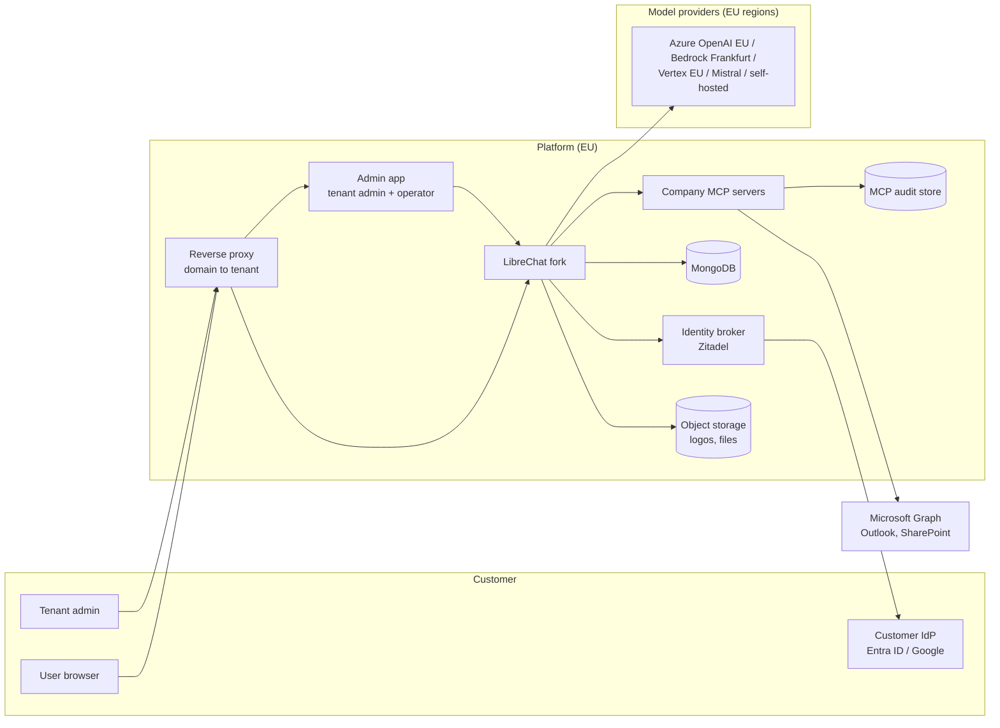
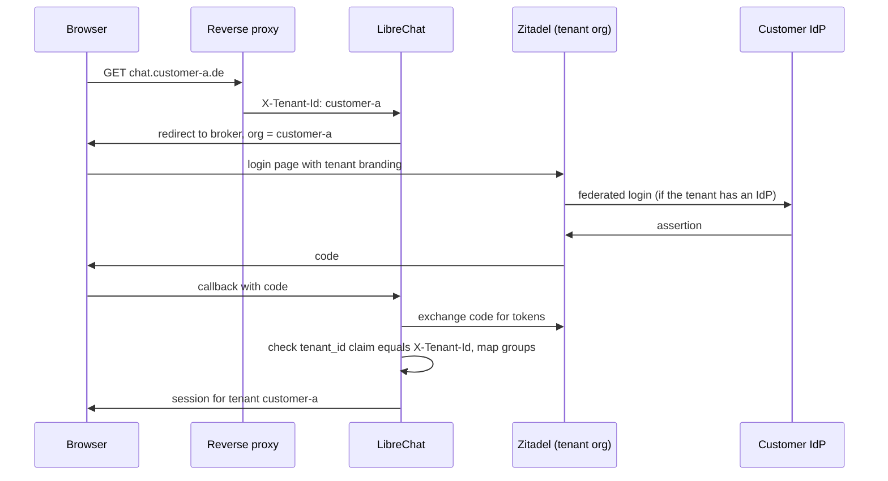
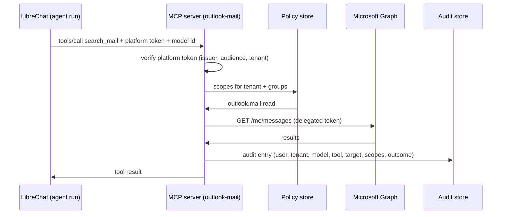

# Platform architecture

Status: draft, 2026-10-19. Fork-only document (`anno-systems/LibreChat`), not part of upstream.
It is the reference for all platform work across the repositories listed below. Change it when a
decision changes; record the change under [Decisions](#decisions).

## Product

A multi-tenant AI platform for companies, hosted entirely in Germany/the EU, with no lock-in to a
model vendor. Each customer (tenant) gets its own domain, login, branding, model selection, limits
and dashboards, administered by the customer's own admins. The differentiator is a set of
company-grade MCP servers: every tool call runs under a verified user identity, inside permission
scopes the tenant admin controls, and leaves an audit entry stating which model did what on behalf
of which user.

Principles:

- **EU residency is checkable.** Everything that stores or processes customer data, including the
  model endpoints, runs in the EU, and the tenant admin can see where each part runs.
- **The operator defines the catalog, tenants choose from it.** Models, providers and MCP servers
  are offered by the operator with region and price. Tenant admins enable and limit them; they do
  not add arbitrary endpoints (bring-your-own-key may come later as an explicit option).
- **Enforcement lives where the data is.** MCP servers check scopes and write their own audit trail.
  LibreChat passes identity; it is not the only line of defence.
- **The LibreChat fork stays thin.** New behaviour is additive and configurable; product code lives
  in its own repositories. See [Fork strategy](#fork-strategy).

## System overview

## Repositories

All repositories live in the `anno-systems` GitHub organization, are planned on one org-level
GitHub Project ("AI Platform"), and publish images to `ghcr.io/anno-systems/*`.

| Repository       | Contents                                                                                                                                     |
| ---------------- | -------------------------------------------------------------------------------------------------------------------------------------------- |
| `librechat`      | This fork. Tenant claim mapping, branding fields, MCP identity propagation, tool-call audit events, operator API module.                     |
| `admin-app`      | One admin application for tenant admins and the operator, built new. See [Admin app](#admin-app).                                            |
| `mcp-servers`    | Monorepo: a shared core (platform token check, scopes, audit writer, Microsoft OAuth, tenant settings) and one package and image per server. |
| `platform-infra` | Deployment: local Docker Compose stack, Terraform for T Cloud Public, reverse proxy, Zitadel configuration, per-tenant routing, backups.     |

## Tenancy

### What upstream provides

Verified in the code at `9008c47`:

- A tenant is an opaque `tenantId` string held in AsyncLocalStorage
  (`packages/data-schemas/src/config/tenantContext.ts`).
- A mongoose plugin filters every query and stamps every write with the tenant
  (`packages/data-schemas/src/models/plugins/tenantIsolation.ts`, rules in
  `packages/data-schemas/src/tenant/policy.ts`). About 45 collections are covered: users,
  conversations, messages, agents, MCP servers, groups, roles, config, balances, transactions,
  files and ACL entries among them. `TENANT_ISOLATION_STRICT=true` rejects requests without a
  tenant.
- After login the tenant comes from `user.tenantId` (`packages/api/src/middleware/tenant.ts`).
  Before login it comes only from the `X-Tenant-Id` header when `TRUST_TENANT_HEADER=true`
  (`packages/api/src/middleware/preAuthTenant.ts`). Upstream deliberately does no host or claim
  resolution.

### What we add

- **Tenant registry.** A `Tenant` record: id, display name, domains, status (active, suspended),
  plan, Zitadel organization id, data-residency facts shown to the tenant admin. Owned by the
  operator API, stored through a `packages/data-schemas` method.
- **Domain to tenant.** The reverse proxy maps each custom domain to its tenant id and sets
  `X-Tenant-Id`, overwriting any value the client sent. LibreChat trusts the header only from the
  proxy (`TRUST_TENANT_HEADER=true` behind a proxy that strips client copies).
- **Claim to tenant.** At OIDC login, LibreChat takes the tenant from a claim in the broker's token
  and checks it against the header. A mismatch fails the login. This closes the gap where a user of
  tenant A logs in on tenant B's domain.
- **First admin.** Upstream only makes the first user of a tenantless deployment an admin
  (`api/server/services/AuthService.js`). Tenant admins are instead assigned by the operator when
  the tenant is created, or derived from a broker role.
- **Strict mode on.** Production runs with `TENANT_ISOLATION_STRICT=true`.

## Identity and login

Customers can log in through their own identity provider or with local accounts. Both run through
one identity broker, so LibreChat sees exactly one OIDC issuer.

- **Broker: Zitadel** (self-hosted in the EU). One Zitadel organization per tenant. Per
  organization: connected IdPs (Entra ID, Google Workspace, generic OIDC/SAML), local accounts with
  password reset and MFA, and login-page branding (logo, colors). Keycloak with one realm per tenant
  is the fallback if Zitadel falls short.
- **Organization id = tenant id.** Each tenant's Zitadel organization is created with the tenant
  id as its organization id (Zitadel accepts a caller-chosen id), so no mapping table is needed.
- **Token contents.** The ID token carries `sub`, `email` and Zitadel's resource-owner claims;
  `urn:zitadel:iam:user:resourceowner:id` is the user's organization, which is the tenant.
  Group membership from the customer IdP is mapped to platform groups in the broker (not built
  yet).
- **Group sync.** Platform groups are mirrored into LibreChat's Group collection so that config
  overrides and ACLs per group work as upstream intends.
- **Admins.** Tenant admins log in to the admin app through their tenant's organization. The
  operator logs in through a separate operator organization with mandatory MFA.

### Tenant-aware OpenID in the fork

Upstream builds the OpenID callback and redirects from the single `DOMAIN_SERVER` and
`DOMAIN_CLIENT`, and cannot ask the provider for a tenant's organization. The fork adds four
optional settings (`packages/api/src/auth/openid/tenant.ts`); unset, behaviour is upstream's:

| Variable               | Example                                                                | Effect                                                                                              |
| ---------------------- | ---------------------------------------------------------------------- | --------------------------------------------------------------------------------------------------- |
| `TENANT_DOMAIN_SERVER` | `https://{tenantid}.example.com`                                       | OpenID callback URL per tenant                                                                      |
| `TENANT_DOMAIN_CLIENT` | `https://{tenantid}.example.com`                                       | Redirect after login, failure, rate limit and ban                                                   |
| `OPENID_TENANT_SCOPE`  | `urn:zitadel:iam:org:id:{tenantid} urn:zitadel:iam:user:resourceowner` | Scopes added per tenant: log in to that organization and include the resource-owner claims          |
| `OPENID_TENANT_CLAIM`  | `urn:zitadel:iam:user:resourceowner:id`                                | ID token claim that must equal the request tenant; otherwise the login fails before any user lookup |

After login, `TENANT_HEADER_MATCH_USER=true` (with `TRUST_TENANT_HEADER=true`) makes every
authenticated request check that the user's tenant equals the proxy's `X-Tenant-Id`, so a session
of one tenant cannot be used through another tenant's hostname (403).

These are environment variables like the rest of upstream's OpenID settings, which all live in
the environment rather than `librechat.yaml`. Zitadel's login UI does not itself stop a user of
another organization from signing in; the claim check is what rejects that login (verified
end to end in `platform-infra`).

## Configuration and model catalog

Upstream already resolves configuration in layers: the YAML file, then a tenant base document,
then group, role and user documents by priority (`packages/data-schemas/src/app/resolution.ts`,
`packages/api/src/app/service.ts`). Endpoints, model lists, model specs, interface settings,
balance and remote MCP servers can all be overridden per layer.

The platform builds on that instead of inventing a second config system:

| Layer                | Who sets it                      | Contents                                                                                                               |
| -------------------- | -------------------------------- | ---------------------------------------------------------------------------------------------------------------------- |
| `librechat.yaml`     | Operator, at deploy              | The full catalog: every provider endpoint with keys, region and price; locked sections (`filters`, stdio MCP servers). |
| Tenant base document | Operator (plan) and tenant admin | Which catalog entries the tenant may use, default model, balance policy, theme.                                        |
| Group documents      | Tenant admin                     | Narrower model sets and limits per group.                                                                              |
| User documents       | Tenant admin (rare)              | Exceptions.                                                                                                            |

Open point: upstream has no "model" permission, so "group X may use model Y" is expressed as a
group-level override of endpoints and model specs. The admin app hides that detail behind a
"models per group" screen.

## Admin app

One application serves both tenant admins and the operator, so there is one codebase, one design
system and one deployment. It is built new rather than forked: the official
[ClickHouse/librechat-admin-panel](https://github.com/ClickHouse/librechat-admin-panel) is licensed
AGPL-3.0, which would oblige us to publish the source of our modified version to every user of it
over the network, while LibreChat itself is MIT. The new app is written clean-room: it uses
upstream's documented `/api/admin/*` API but copies no code from the AGPL panel.

| Area          | Who sees it                                | Backend                                                                | Functions                                                                                                                                                                   |
| ------------- | ------------------------------------------ | ---------------------------------------------------------------------- | --------------------------------------------------------------------------------------------------------------------------------------------------------------------------- |
| Tenant area   | Tenant admins, limited to their own tenant | Upstream `/api/admin/*` in the tenant's context, extended where needed | Users and groups, models per group, agents, enabling MCP servers and assigning scopes, branding, budgets, usage dashboards, audit viewer                                    |
| Operator area | The operator only                          | New operator API module in the fork                                    | Create, suspend and delete tenants; domains; Zitadel organization; plans; model catalog with regions and prices; MCP catalog; health; cross-tenant usage and billing export |

Separation rules, because one app now holds both:

- The operator area is enforced by the backend, not by hiding menu items. The operator API accepts
  only operator tokens from the operator organization, with MFA.
- The operator area is served only on the operator hostname (for example
  `admin.<platform-domain>`); on customer domains the app shows the tenant area only.
- The operator API works across tenants (`runAsSystem`), so it is the most sensitive surface in
  the system: every call is written to the audit log.

## Branding

Upstream supports runtime theme colors per tenant (`interface.theme`). Missing, and added by the
fork as config fields with defaults that reproduce today's behaviour:

- logo (today hardcoded as `assets/logo.svg` in `client/src/components/Auth/AuthLayout.tsx`),
- app title and footer (today env-only, `api/server/routes/config.js`),
- favicon.

Assets are uploaded through the admin app to object storage and served by URL, so a new
logo never needs a new image. The login page itself is branded in Zitadel per organization.

## Usage, limits and dashboards

Upstream provides a per-user balance with refill (`packages/data-schemas/src/schema/balance.ts`)
and a transaction per model call with user, model, tokens and tenant
(`packages/data-schemas/src/schema/transaction.ts`). Balance policy can already differ per tenant
and group.

Added:

- **Budgets per group and tenant**, checked next to the user balance in
  `packages/api/src/middleware/checkBalance.ts`.
- **Usage endpoints** for dashboards, aggregated by user, group, model and day, gated by the
  existing but unused `read:usage` capability (`packages/data-schemas/src/admin/capabilities.ts`).
- **Dashboards** in the tenant area of the admin app; cross-tenant usage and cost in the operator
  area.

## MCP platform

### Two identities per call

A tool call to a company MCP server carries two separate identities:

1. **Platform identity**: who the user is on the platform (user, tenant, groups). It decides the
   platform scopes and is what the audit trail records. Issued by the broker, verified by the MCP
   server against the broker's keys.
2. **Delegated application token**: what the target application allows the user, for example a
   Microsoft Graph token with `Mail.Read`. Obtained by the MCP server's own OAuth flow, which
   LibreChat already supports per user (`packages/api/src/mcp/oauth/`). It is independent of how the
   user logged in to the platform, so it also works for local-account users.

The effective permission of a call is the intersection: platform scopes granted by the tenant admin
and permissions granted by the application.

### Passing identity from LibreChat

What exists: MCP headers can carry user fields and OIDC tokens through placeholders such as
`{{LIBRECHAT_USER_ID}}` and `{{LIBRECHAT_OPENID_ACCESS_TOKEN}}` (`packages/api/src/utils/env.ts`),
and an on-behalf-of exchange exists in `packages/api/src/mcp/oauth/obo.ts`.

Gaps to close in the fork:

- `tenantId` is not available to MCP placeholders (`packages/api/src/utils/headers.ts` covers model
  endpoints only).
- The model that triggered a tool call is not passed to the MCP server. It is asserted by LibreChat,
  not signed by the broker, so the MCP server trusts it only over an authenticated channel between
  LibreChat and the MCP server (mTLS or a per-deployment secret).

Open decision: forward the user's OIDC access token as is (works today, but its audience is
LibreChat), or exchange it for a token whose audience is the MCP server (preferred; needs token
exchange in the broker or the existing OBO path).

### Scopes

- Scopes are named per server and action, for example `outlook.mail.read`, `outlook.mail.send`,
  `outlook.calendar.read`, `sharepoint.site.read`, with optional resource qualifiers (a site, a
  mailbox).
- The tenant admin assigns scopes to platform groups in the admin app.
- Write actions (send mail, create event, upload file) additionally require user confirmation in
  the chat, using upstream's tool approval modes (`docs/tool-approval-modes.md`).
- Open decision: whether scopes travel as token claims (simple, but stale until re-login) or are
  read by the MCP server from a per-tenant policy store (current, needs a lookup and cache). The
  diagram above assumes the policy store.

### Audit entry

One entry per tool call, written by the MCP server before it returns:

| Field                | Example                                                  |
| -------------------- | -------------------------------------------------------- |
| time, request id     | `2026-10-19T12:00:00Z`, `req_…`                          |
| tenant, user, groups | `customer-a`, `sub` and email, group ids at call time    |
| model                | `azure-openai/gpt-…` (asserted by LibreChat)             |
| conversation, agent  | LibreChat conversation and agent ids                     |
| server, tool, target | `outlook-mail`, `search_mail`, mailbox id                |
| scopes               | platform scope used, delegated scopes held               |
| outcome              | allowed, denied (and which check denied), error, latency |
| integrity            | hash of the previous entry for the tenant (hash chain)   |

Content is not stored by default (data minimisation under GDPR). Arguments are recorded as
redacted summaries or hashes; full arguments only when a tenant opts in. Retention is set per
tenant.

LibreChat additionally writes a platform-side event per tool call into its own hash-chained audit
log (`packages/data-schemas/src/schema/auditLog.ts`, today admin actions only), so the tenant admin
sees one trail in the panel and can verify the MCP server's entries against it.

### First servers

All on Microsoft Graph, sharing one Graph module in the core:

1. `outlook-mail`
2. `outlook-calendar`
3. `sharepoint`

Each customer's Entra admin consents once to the platform's app registration in their Microsoft
tenant; this is an onboarding step and needs a guided flow in the admin app.

Later: GitHub, Azure DevOps, then German accounting and payroll (lexoffice/Lexware Office, sevDesk,
Personio; DATEV requires its partner programme). Payroll data can include special-category data
(GDPR Art. 9), so those servers need the finest-grained scopes.

## Data residency

- Hosting: T Cloud Public (Deutsche Telekom, data centres in Germany) for all platform components
  and backups.
- Models: only EU-region endpoints in the catalog; region shown per model in the admin app.
- MCP targets: the data stays in the customer's own systems (Microsoft 365 etc.); the MCP servers
  do not persist it beyond the audit metadata.
- Telemetry and tracing (for example Langfuse) self-hosted in the EU or off.

## Environments

| Environment | Where               | How                                                                                                                                                                                                                                                                                                    |
| ----------- | ------------------- | ------------------------------------------------------------------------------------------------------------------------------------------------------------------------------------------------------------------------------------------------------------------------------------------------------ |
| Local       | The owner's machine | Docker Compose in `platform-infra`: reverse proxy with one hostname per test tenant (for example `tenant-a.localhost`, `tenant-b.localhost`), LibreChat from `ghcr.io/anno-systems/librechat`, MongoDB, Zitadel with its database, later the admin app and MCP servers. All current work targets this. |
| Production  | T Cloud Public      | Terraform (Open Telekom Cloud provider) in `platform-infra`. Later; the deployment form (VMs with Compose or managed Kubernetes) is decided when we get there.                                                                                                                                         |

## Fork strategy

Rules from `CLAUDE.md` apply: additive changes, no reformatting of upstream files, every deviation
recorded under Customizations there.

Planned changes to this fork:

| Change                                             | Kind                                                              |
| -------------------------------------------------- | ----------------------------------------------------------------- |
| Tenant claim check and group mapping at OIDC login | Additive module in `packages/api`, small hook in the auth wiring  |
| Tenant registry and operator API                   | New module in `packages/api` plus a `packages/data-schemas` model |
| Logo, title, footer, favicon as config fields      | Config schema plus small client change                            |
| `tenantId` and model id available to MCP headers   | Small change, candidate for upstream                              |
| Tool-call audit events                             | New audit actions, emitted from the MCP tool execution path       |
| Group and tenant budgets, usage endpoints          | Additive in `packages/api` and `packages/data-schemas`            |

Generic pieces (MCP tenant placeholder, configurable logo and title) are offered upstream, so the
fork shrinks over time.

## Roadmap

| Phase                          | Goal                                                                                                             | Done when                                                                            |
| ------------------------------ | ---------------------------------------------------------------------------------------------------------------- | ------------------------------------------------------------------------------------ |
| 1. Tenancy spike               | Two tenants on two local hostnames behind a proxy, strict mode, different models, configuration only             | Users of A never see data or models of B; tested across conversations, files, agents |
| 2. Identity                    | Zitadel with one organization per tenant, tenant claim check, group sync, local accounts and one federated IdP   | Both login types work per tenant; a cross-tenant login is rejected                   |
| 3. MCP identity and audit      | Tenant id, model id and platform token reach MCP servers; `mcp-servers` core; `outlook-mail` as reference server | A tool call produces a complete audit entry; a missing scope is denied and audited   |
| 4. Admin app v1: tenant area   | Models per group, users and groups, MCP scopes, branding upload                                                  | A tenant admin configures a new tenant without operator help                         |
| 5. Admin app v1: operator area | Tenant lifecycle, catalog, domains                                                                               | A new tenant goes from signup to first chat through the admin app                    |
| 6. Usage and budgets           | Dashboards, group and tenant budgets                                                                             | A tenant admin sees usage per user, group and model and can cap it                   |
| 7. More MCP servers            | Calendar, SharePoint, then GitHub, Azure DevOps, accounting                                                      | Each ships with scopes, audit and documentation                                      |

## Decisions

Decided:

- Multi-tenant on upstream's tenant isolation, tenant resolved by reverse proxy and checked against
  a token claim.
- Login through an identity broker, one organization per tenant, both federated IdPs and local
  accounts. Zitadel for the start (2026-10-19); Keycloak, which the owner has used before, remains
  the fallback if the hands-on test of per-organization IdPs, branding and token exchange fails.
- One admin app for tenant admins and the operator, built new (2026-10-19). Not a fork of
  `ClickHouse/librechat-admin-panel`, because it is AGPL-3.0.
- Hosting on T Cloud Public, provisioned with Terraform (2026-10-19). All work runs locally with
  Docker Compose until the stack works end to end.
- Company MCP servers in a separate monorepo; first targets Outlook mail, Outlook calendar,
  SharePoint.

- Tenant resolution at login: the fork's tenant-aware OpenID settings; Zitadel organization id
  equals the tenant id (2026-10-19). Locally Zitadel runs on HTTPS through Caddy's local CA,
  because `openid-client` accepts only HTTPS issuers.

Open:

- Platform token: forwarded OIDC token or audience-bound exchanged token.
- Scopes as token claims or from a policy store.
- Where the MCP audit store lives (per-tenant database, shared database with tenant key, or an
  append-only log service) and how tenants export it.
- Production deployment form on T Cloud Public (VMs with Compose or managed Kubernetes).
- Admin app stack.
