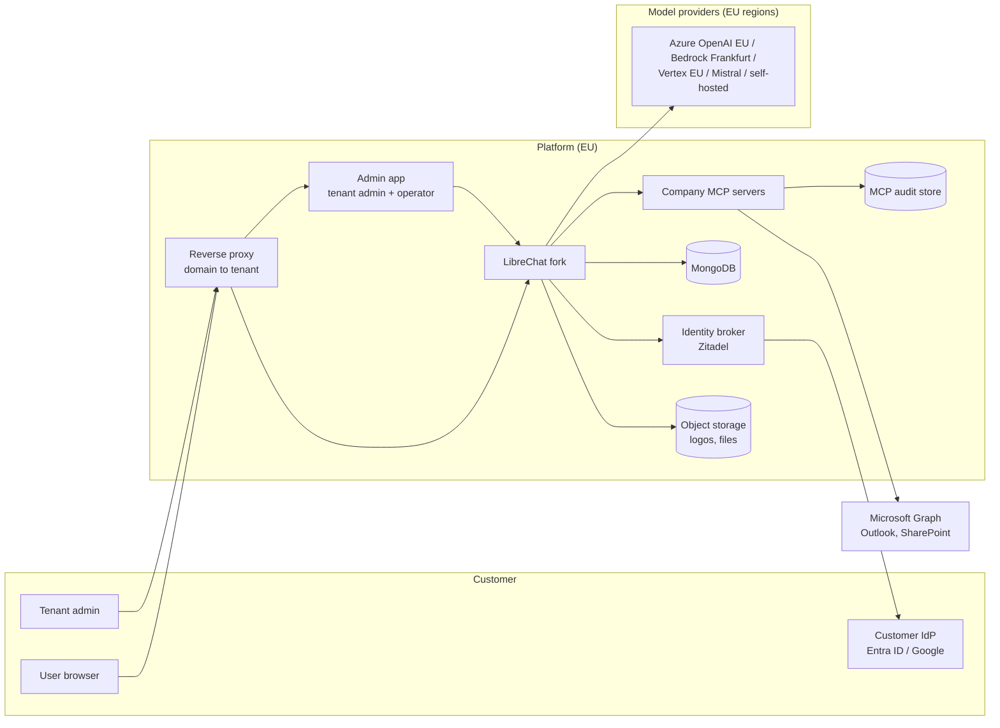
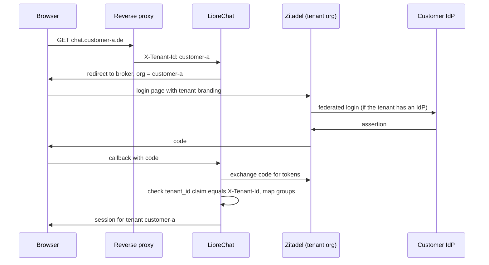
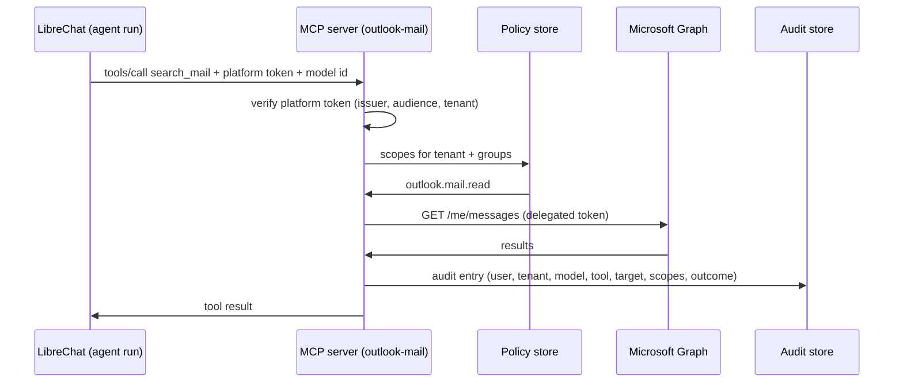

# Platform architecture

Status: draft, 2026-10-19. Fork-only document (`anno-systems/LibreChat`), not part of upstream.
It is the reference for all platform work across the repositories listed below. Change it when a
decision changes; record the change under [Decisions](#decisions).

## Product

A multi-tenant AI platform for companies, hosted entirely in Germany/the EU, with no lock-in to a
model vendor. Each customer (tenant) gets its own domain, login, branding, model selection, limits
and dashboards, administered by the customer's own admins. The differentiator is a set of
company-grade MCP servers: every tool call runs under a verified user identity, inside permission
scopes the tenant admin controls, and leaves an audit entry stating which model did what on behalf
of which user.

Principles:

- **EU residency is checkable.** Everything that stores or processes customer data, including the
  model endpoints, runs in the EU, and the tenant admin can see where each part runs.
- **The operator defines the catalog, tenants choose from it.** Models, providers and MCP servers
  are offered by the operator with region and price. Tenant admins enable and limit them; they do
  not add arbitrary endpoints (bring-your-own-key may come later as an explicit option).
- **Enforcement lives where the data is.** MCP servers check scopes and write their own audit trail.
  LibreChat passes identity; it is not the only line of defence.
- **The LibreChat fork stays thin.** New behaviour is additive and configurable; product code lives
  in its own repositories. See [Fork strategy](#fork-strategy).

## System overview

## Repositories

All repositories live in the `anno-systems` GitHub organization, are planned on one org-level
GitHub Project ("AI Platform"), and publish images to `ghcr.io/anno-systems/*`.

| Repository       | Contents                                                                                                                                     |
| ---------------- | -------------------------------------------------------------------------------------------------------------------------------------------- |
| `librechat`      | This fork. Tenant claim mapping, branding fields, MCP identity propagation, tool-call audit events, operator API module.                     |
| `admin-app`      | One admin application for tenant admins and the operator, built new. See [Admin app](#admin-app).                                            |
| `mcp-servers`    | Monorepo: a shared core (platform token check, scopes, audit writer, Microsoft OAuth, tenant settings) and one package and image per server. |
| `platform-infra` | Deployment: local Docker Compose stack, Terraform for T Cloud Public, reverse proxy, Zitadel configuration, per-tenant routing, backups.     |

## Tenancy

### What upstream provides

Verified in the code at `9008c47`:

- A tenant is an opaque `tenantId` string held in AsyncLocalStorage
  (`packages/data-schemas/src/config/tenantContext.ts`).
- A mongoose plugin filters every query and stamps every write with the tenant
  (`packages/data-schemas/src/models/plugins/tenantIsolation.ts`, rules in
  `packages/data-schemas/src/tenant/policy.ts`). About 45 collections are covered: users,
  conversations, messages, agents, MCP servers, groups, roles, config, balances, transactions,
  files and ACL entries among them. `TENANT_ISOLATION_STRICT=true` rejects requests without a
  tenant.
- After login the tenant comes from `user.tenantId` (`packages/api/src/middleware/tenant.ts`).
  Before login it comes only from the `X-Tenant-Id` header when `TRUST_TENANT_HEADER=true`
  (`packages/api/src/middleware/preAuthTenant.ts`). Upstream deliberately does no host or claim
  resolution.

### What we add

- **Tenant registry.** The Zitadel organizations are the registry: a tenant is an organization
  with the tenant id as its id, and the admin app's tenants are the organizations its service
  user belongs to. Suspension is the organization's state (deactivated), custom domains are the
  organization's metadata `chat_domains`. A `Tenant` record stored through a
  `packages/data-schemas` method follows only when plans or data-residency facts need data
  Zitadel does not hold.
- **Domain to tenant.** The reverse proxy strips any `X-Tenant-Id` and `X-Tenant-Origin` the
  client sent and asks the admin app's tenant router (`GET /internal/route`, Caddy
  `forward_auth`) which tenant the host is. The router answers from the registry, cached for
  30 seconds (an unknown host reloads it at most every 5 seconds, a failed reload keeps the last
  list): 200 with `X-Tenant-Id` for an active tenant, 403 with a short page for a suspended one,
  404 for a host that names no tenant. Platform subdomains follow the tenant URL template
  (`<tenant>.<platform domain>`); any other host is looked up among the custom domains, and the
  router then also sends `X-Tenant-Origin`, the domain's public origin. LibreChat trusts both
  headers only from the proxy (`TRUST_TENANT_HEADER=true`).
- **Custom domains** (2026-10-20). The operator sets up to ten domains per tenant in the admin
  app; a domain belongs to one tenant only and platform hosts are refused. Setting them adds the
  domains' callback URLs to LibreChat's OIDC app and to the tenant organization's domains. With
  `X-Tenant-Origin`, LibreChat uses that origin for the request's OpenID callback, redirects and
  `serverDomain` instead of the `TENANT_DOMAIN_*` templates
  (`packages/api/src/middleware/tenantOrigin.ts`). In production Caddy issues certificates on
  demand and asks the router first (`GET /internal/tls?domain=`), so it never requests one for a
  host that is not a tenant's domain. The customer points a CNAME at the platform.
- **Suspending and deleting a tenant** (2026-10-20). The operator suspends a tenant in the admin
  app, which deactivates its Zitadel organization: its users cannot sign in, the router answers
  403 on its hosts and its admins get `tenant_suspended`. Only a suspended tenant can be deleted,
  after the operator types its id. Deletion first purges LibreChat (`DELETE
/api/platform/tenants/:id`: every user is erased through upstream's erasure path, then every
  document with that `tenantId` except the append-only audit log, which records `tenant.purged`),
  then deletes the Zitadel organization. A failed purge stops before Zitadel, so it can be
  retried.
- **Claim to tenant.** At OIDC login, LibreChat takes the tenant from a claim in the broker's token
  and checks it against the header. A mismatch fails the login. This closes the gap where a user of
  tenant A logs in on tenant B's domain.
- **First admin.** Upstream only makes the first user of a tenantless deployment an admin
  (`api/server/services/AuthService.js`). Tenant admins are instead assigned by the operator when
  the tenant is created, or derived from a broker role.
- **Strict mode on.** Production runs with `TENANT_ISOLATION_STRICT=true`.

## Identity and login

Customers can log in through their own identity provider or with local accounts. Both run through
one identity broker, so LibreChat sees exactly one OIDC issuer.

- **Broker: Zitadel** (self-hosted in the EU). One Zitadel organization per tenant. Per
  organization: connected IdPs (Entra ID, Google Workspace, generic OIDC/SAML), local accounts with
  password reset and MFA, and login-page branding (logo, colors). Keycloak with one realm per tenant
  is the fallback if Zitadel falls short.
- **Organization id = tenant id.** Each tenant's Zitadel organization is created with the tenant
  id as its organization id (Zitadel accepts a caller-chosen id), so no mapping table is needed.
- **Token contents.** The ID token carries `sub`, `email` and Zitadel's resource-owner claims;
  `urn:zitadel:iam:user:resourceowner:id` is the user's organization, which is the tenant.
- **Group sync** (2026-10-20). At every sign-in through a tenant's identity provider, Zitadel
  calls the admin app (`/hooks/zitadel/idp-intent`, a signed Actions target). The admin app reads
  the provider's groups claim and stores `{ idp, groups }` as the user's Zitadel metadata
  `idp_groups`, so the next token carries the current groups. LibreChat, with
  `OPENID_GROUPS_CLAIM`, makes the user's memberships match that claim at each OpenID sign-in.
  Synced groups have source `oidc` and the id `<provider>:<group>`, so two providers of one
  tenant cannot collide and a sync never touches local groups. Missing groups are created, named
  after their id until an admin renames them. A failed sync is logged and the sign-in goes on.
- **Admins.** Tenant admins log in to the admin app through their tenant's organization. The
  operator logs in through a separate operator organization with mandatory MFA.

### Tenant-aware OpenID in the fork

Upstream builds the OpenID callback and redirects from the single `DOMAIN_SERVER` and
`DOMAIN_CLIENT`, and cannot ask the provider for a tenant's organization. The fork adds four
optional settings (`packages/api/src/auth/openid/tenant.ts`); unset, behaviour is upstream's:

| Variable               | Example                                                                                                                               | Effect                                                                                                                                |
| ---------------------- | ------------------------------------------------------------------------------------------------------------------------------------- | ------------------------------------------------------------------------------------------------------------------------------------- |
| `TENANT_DOMAIN_SERVER` | `https://{tenantid}.example.com`                                                                                                      | OpenID callback URL per tenant                                                                                                        |
| `TENANT_DOMAIN_CLIENT` | `https://{tenantid}.example.com`                                                                                                      | Redirect after login, failure, rate limit and ban                                                                                     |
| `OPENID_TENANT_SCOPE`  | `urn:zitadel:iam:org:id:{tenantid} urn:zitadel:iam:user:resourceowner urn:zitadel:iam:org:domain:primary:{tenantid}.auth.example.com` | Scopes added per tenant: log in to that organization, include the resource-owner claims, and let the login page find the organization |
| `OPENID_TENANT_CLAIM`  | `urn:zitadel:iam:user:resourceowner:id`                                                                                               | ID token claim that must equal the request tenant; otherwise the login fails before any user lookup                                   |

After login, `TENANT_HEADER_MATCH_USER=true` (with `TRUST_TENANT_HEADER=true`) makes every
authenticated request check that the user's tenant equals the proxy's `X-Tenant-Id`, so a session
of one tenant cannot be used through another tenant's hostname (403).

With `OPENID_REUSE_TOKENS=true`, which MCP token forwarding needs, LibreChat authenticates
requests with the provider's own token (`openidJwt` strategy). Upstream looks that user up before
any tenant context exists, so strict isolation answers 500 on every authenticated route. The
fork runs that lookup in the proxy's tenant and applies `OPENID_TENANT_CLAIM` to the bearer
token as well, so a token of tenant A sent through tenant B's hostname gets 401.

Tenant admins use LibreChat's own admin login (`/api/admin/oauth/openid`), which the fork makes
tenant-aware like the user login: the tenant's own callback, its organization scope and the
claim check. Zitadel's project role `tenant-admin`, granted per tenant organization, makes a
user a LibreChat admin of that tenant (`OPENID_ADMIN_ROLE=tenant-admin`,
`OPENID_ADMIN_ROLE_PARAMETER_PATH=urn:zitadel:iam:org:project:roles`). Upstream's admin login
accepts only users who already exist, so a new admin signs in to the chat once first.

These are environment variables like the rest of upstream's OpenID settings, which all live in
the environment rather than `librechat.yaml`. Zitadel's login UI does not itself stop a user of
another organization from signing in; the claim check is what rejects that login (verified
end to end in `platform-infra`).

Zitadel's login app reads the organization from `urn:zitadel:iam:org:id:` only when the id is
numeric, and our organization ids are the tenant ids. Without more, the login page therefore runs
in the default organization: no tenant branding and none of the tenant's identity providers
(the claim check is unaffected, because Zitadel's core applies the scope). Each tenant
organization therefore has the primary domain `<tenant>.<auth host>`, and the tenant scope also
names it with `urn:zitadel:iam:org:domain:primary:`, which the login page resolves. With the
organization known, users sign in with their email address (2026-10-20).

### Single sign-on per tenant

A tenant admin connects the company's identity provider (Microsoft Entra ID or any OpenID
Connect provider) in the admin app. The admin app creates the provider as a template in the
tenant's Zitadel organization, gives the organization its own login policy and activates the
provider there, so it appears on that tenant's sign-in page only. It acts with one Zitadel
service user that holds `ORG_SETTINGS_MANAGER` and `ORG_USER_MANAGER` in each tenant organization and nothing else
(platform-infra's provisioner), always naming the session's organization. Client secrets go to
Zitadel only. Issuers must be HTTPS on a public host name, because Zitadel fetches their
discovery document; an egress policy for Zitadel is what fully prevents a public name resolving
to a private address.

## Configuration and model catalog

Upstream already resolves configuration in layers: the YAML file, then a tenant base document,
then group, role and user documents by priority (`packages/data-schemas/src/app/resolution.ts`,
`packages/api/src/app/service.ts`). Endpoints, model lists, model specs, interface settings,
balance and remote MCP servers can all be overridden per layer.

The platform builds on that instead of inventing a second config system:

| Layer                | Who sets it                      | Contents                                                                                                               |
| -------------------- | -------------------------------- | ---------------------------------------------------------------------------------------------------------------------- |
| `librechat.yaml`     | Operator, at deploy              | The full catalog: every provider endpoint with keys, region and price; locked sections (`filters`, stdio MCP servers). |
| Tenant base document | Operator (plan) and tenant admin | Which catalog entries the tenant may use, default model, balance policy, theme, branding.                              |
| Group documents      | Tenant admin                     | Narrower model sets, greeting and credit limits per group.                                                             |
| User documents       | Tenant admin (rare)              | Exceptions.                                                                                                            |

Models and settings per group (2026-10-20): upstream has no "model" permission, so "group X
may use model Y" is a group config document that narrows the tenant's model lists, written by
the admin app's groups screen together with the group's greeting and credit limits. Groups are
the synced ones (members from the identity provider) and the tenant's own (members added in the
admin app). The groups with settings form an ordered list whose order sets the documents'
priorities, so for someone in several groups the group higher in the list wins.

### Catalog per tenant

The YAML catalog is the same for every tenant. The fork adds a catalog per tenant
(`packages/api/src/platform/catalog.ts`, `packages/data-schemas/src/methods/platformCatalog.ts`),
active with `ADMIN_CONFIG_CATALOG_LOCK=true` (2026-10-20):

- **Platform providers.** The operator keeps providers (base URL, encrypted key, models) in
  LibreChat and assigns each tenant providers and a subset of their models. The operator API
  (`/api/platform/*`) is reachable only with `PLATFORM_API_TOKEN` from the admin app's server,
  is off (404) without a token of at least 32 characters, and is blocked at the proxy.
- **Own providers (BYOK).** A tenant admin adds up to ten providers with their own key
  (`/api/admin/catalog`). The base URL must be HTTPS and pass the SSRF check; names may not
  shadow a platform provider.
- LibreChat adds the tenant's endpoints to the base config before the tenant's documents are
  applied, reloading them at most every 30 seconds, so the existing narrowing and the per-group
  documents work on them unchanged. Keys never leave the server: `/api/endpoints`,
  `/api/models` and `/api/config` show names and models only.

### Catalog lock

Tenant admins are LibreChat admins of their tenant and can call `/api/admin/config` with their
own token, not only through the admin app. Upstream lets such a write set any endpoint field and
resolves `${NAME}` references from the server's environment at request time. A tenant admin could
therefore point a catalog endpoint's `baseURL` at their own server and receive the operator's
provider key, or set a web search key to `${JWT_SECRET}` or another tenant's search key (the web
search path does not apply upstream's sensitive-variable denylist).

`ADMIN_CONFIG_CATALOG_LOCK=true` (fork, `packages/api/src/admin/catalog.ts`) closes that:

- `endpoints` writes may only name a custom endpoint from `librechat.yaml` and set
  `models.default` to a subset of its catalog list. Every other endpoint field and section is
  refused, as are endpoints the catalog does not have.
- No written value may contain `${…}`. Operator-owned references such as the tenants' search keys
  are written by the operator directly (`platform-infra` seed), not through the API.

LibreChat enforces the resulting list on every chat request (`validateAgentModel`, a model outside
the list fails with `illegal_model_request`), so the narrowing is a real limit, not a UI filter.
Catalog endpoints must list their models (`fetch: false`); a fetched list would replace the
narrowing. The lock is an environment switch rather than a `librechat.yaml` field so it is never
writable through the API it guards.

## Admin app

One application serves both tenant admins and the operator, so there is one codebase, one design
system and one deployment. It is built new rather than forked: the official
[ClickHouse/librechat-admin-panel](https://github.com/ClickHouse/librechat-admin-panel) is licensed
AGPL-3.0, which would oblige us to publish the source of our modified version to every user of it
over the network, while LibreChat itself is MIT. The new app is written clean-room: it uses
upstream's documented `/api/admin/*` API but copies no code from the AGPL panel.

| Area          | Who sees it                                | Backend                                                                | Functions                                                                                                                                                                   |
| ------------- | ------------------------------------------ | ---------------------------------------------------------------------- | --------------------------------------------------------------------------------------------------------------------------------------------------------------------------- |
| Tenant area   | Tenant admins, limited to their own tenant | Upstream `/api/admin/*` in the tenant's context, extended where needed | Users and groups, models per group, agents, enabling MCP servers and assigning scopes, branding, budgets, usage dashboards, audit viewer, SSO                               |
| Operator area | The operator only                          | New operator API module in the fork                                    | Create, suspend and delete tenants; domains; Zitadel organization; plans; model catalog with regions and prices; MCP catalog; health; cross-tenant usage and billing export |

Built so far (2026-10-20), in the tenant area:

| Function            | Backend                                                                                                               |
| ------------------- | --------------------------------------------------------------------------------------------------------------------- |
| Greeting            | `interface.customWelcome` in the tenant's base document                                                               |
| Features            | `USE` of role permissions (agents, web search, file search, MCP, skills, memory, code, prompts, bookmarks …)          |
| Models              | Narrowing of the YAML catalog in the base document, under the catalog lock                                            |
| Agents for everyone | Upstream's public viewer grant on an agent (`/api/permissions/agent/:id`), kept inside the tenant by isolation        |
| User limits         | `balance.*` in the base document; one user's credits through the fork's `/api/admin/users/:id/balance`                |
| Web search usage    | The search gateway's usage report, asked for the session's tenant only                                                |
| Single sign-on      | Identity providers in the tenant's Zitadel organization (see [Single sign-on per tenant](#single-sign-on-per-tenant)) |
| Users               | Upstream's user list and admin erasure (`ADMIN_USER_DELETION`)                                                        |
| Invitations         | An account without a password in the tenant's Zitadel organization and Zitadel's invite email                         |

And in the operator area, on `/operator` of the same app: **create a tenant**. The operator signs
in to Zitadel with the admin app's own OIDC client (operator role of the platform organization,
second factor required). With an operator service user (`IAM_ORG_MANAGER`, `ORG_OWNER` of the
platform organization) the admin app creates the organization with the tenant id, its primary
domain and branding, grants it LibreChat's project, adds the admin app's service user, adds the
tenant's callback URLs to LibreChat's OIDC app and invites the first admin with `tenant-admin`.
A failed step undoes the ones before it. LibreChat itself needs nothing per tenant. The operator
area also suspends, reactivates and deletes tenants, sets their custom domains and keeps the
platform providers of the tenant catalog. Missing: plans, and a web search key for new
tenants.

The admin app keeps LibreChat's admin token on its server and refreshes it about a minute before
`SESSION_EXPIRY` through upstream's `/api/admin/oauth/refresh`. Agents and their permissions live
on LibreChat's user-facing API, which bans clients that are not browsers by user and IP; those
calls forward the admin's own browser user agent. Every call also carries the admin's own address
in `X-Forwarded-For`, which LibreChat trusts from its first hop (`TRUST_PROXY`), so LibreChat's
per-IP login and refresh limits (`LOGIN_MAX`), its violation bans and its audit entries apply to
each admin, not to the admin app's single address.

Decision: limits and bans stay per admin address, not per tenant. A tenant-keyed limit would let
one admin's failures, or an attacker who knows a tenant's id, lock out every admin of that
tenant; a per-address limit confines that to the address that misbehaves.

Separation rules, because one app now holds both:

- The operator area is enforced by the backend, not by hiding menu items. The operator API accepts
  only operator tokens from the operator organization, with MFA.
- The operator area is served only on the operator hostname (for example
  `admin.<platform-domain>`); on customer domains the app shows the tenant area only.
- The operator API works across tenants (`runAsSystem`), so it is the most sensitive surface in
  the system: every call is written to the audit log.

## Branding

Tenant admins brand their tenant in the admin app (2026-10-20). The fork adds
`interface.branding` (`packages/data-provider/src/branding.ts`): app title, logo, favicon and
footer, unset by default so upstream's look stays. Images are HTTPS URLs or small data URLs
(PNG, JPEG, WebP, GIF, SVG or ICO, at most 128 KB) stored in the tenant's base document, so no
object storage is needed yet. Title and logo reach the sign-in page before login; the footer
only after it. The accent color is upstream's `interface.theme` with a `tenant-accent` theme.

The same save brands the Zitadel login page of the tenant's organization (label policy, logo
and icon assets). Zitadel's login app caches branding for an hour by default; the stack lowers
that to five minutes (`API_CACHE_CONFIG`).

### Deleting a user (data protection)

A tenant admin erases a user in the admin app. It calls upstream's admin erasure handler, which
the fork routes behind `ADMIN_USER_DELETION=true` (`DELETE /api/admin/users/:id`): it stops the
user's generations and schedules and deletes conversations, messages, files, memories, own
agents, shares, sessions and settings, inside the admin's tenant only.

The admin app also deletes the user's Zitadel account. It finds the account by the user's email
address inside the tenant's organization and deactivates it first, so the user cannot sign in
during the erasure. LibreChat then erases the data, and the app deletes the account. A refused
erasure reactivates the account. Several accounts with the address stop the deletion before
anything changes. An account Zitadel fails to delete stays deactivated, and the admin is told to
ask the operator. The admin app's service user is `ORG_USER_MANAGER` in each tenant organization
for this.

Still open: pseudonymizing the user in the MCP audit logs (the subject is replaced by a keyed
pseudonym whose key is deleted, so the hash chain stays valid).

## Usage, limits and dashboards

Web search usage per tenant comes from the search gateway's `search_usage` table
(`GET /usage?month=YYYY-MM`, operator token); see the decision below.

Upstream provides a per-user balance with refill (`packages/data-schemas/src/schema/balance.ts`)
and a transaction per model call with user, model, tokens and tenant
(`packages/data-schemas/src/schema/transaction.ts`). Balance policy can already differ per tenant
and group.

Tenant admins set the user limits in the admin app (2026-10-20): the tenant's balance policy is
`balance.*` in its base document (start balance, automatic refill), and a user's own balance is
read and set through the fork's `GET`/`PUT /api/admin/users/:id/balance`, which upstream only
offers as a CLI script. A user at zero credits is refused with `token_balance` until the balance
is raised or refilled. Every set is in the admin audit log (`user.balance_updated`).

Added:

- **Budgets per group and tenant**, checked next to the user balance in
  `packages/api/src/middleware/checkBalance.ts`.
- **Usage endpoints** for dashboards, aggregated by user, group, model and day, gated by the
  existing but unused `read:usage` capability (`packages/data-schemas/src/admin/capabilities.ts`).
- **Dashboards** in the tenant area of the admin app; cross-tenant usage and cost in the operator
  area.

## MCP platform

### Two identities per call

A tool call to a company MCP server carries two separate identities:

1. **Platform identity**: who the user is on the platform (user, tenant, groups). It decides the
   platform scopes and is what the audit trail records. Issued by the broker, verified by the MCP
   server against the broker's keys.
2. **Delegated application token**: what the target application allows the user, for example a
   Microsoft Graph token with `Mail.Read`. Obtained by the MCP server's own OAuth flow, which
   LibreChat already supports per user (`packages/api/src/mcp/oauth/`). It is independent of how the
   user logged in to the platform, so it also works for local-account users.

The effective permission of a call is the intersection: platform scopes granted by the tenant admin
and permissions granted by the application.

### Passing identity from LibreChat

What exists: MCP headers can carry user fields and OIDC tokens through placeholders such as
`{{LIBRECHAT_USER_ID}}` and `{{LIBRECHAT_OPENID_ACCESS_TOKEN}}` (`packages/api/src/utils/env.ts`),
and an on-behalf-of exchange exists in `packages/api/src/mcp/oauth/obo.ts`.

Current setup (verified end to end in `platform-infra`, 2026-10-19): LibreChat runs with
`OPENID_REUSE_TOKENS=true` and `offline_access`, and each platform MCP server is defined in
`librechat.yaml` with `Authorization: Bearer {{LIBRECHAT_OPENID_ACCESS_TOKEN}}`. The MCP server
verifies the Zitadel access token (issuer, signature, audience = LibreChat's client id) and
reads the tenant from `urn:zitadel:iam:user:resourceowner:id`. Only servers from YAML or tenant
config receive identity placeholders; servers users create in the UI do not.

Gaps to close in the fork:

- `tenantId` is not available to MCP placeholders (`packages/api/src/utils/headers.ts` covers model
  endpoints only). Not needed by the platform servers, which take the tenant from the token.
- Model, agent, conversation and message reach the MCP server in each `tools/call` request's
  `_meta` (`librechat/context`) when the server sets `callContext: true` (fork, 2026-10-20). They
  are asserted by LibreChat, not signed by the broker: the MCP server records them in the audit
  entry and never decides access on them. `_meta` rather than headers, because headers belong to
  the connection and body placeholders would force a new connection per request.
- The forwarded token's audience is LibreChat, so any platform MCP server could replay it to
  another. An exchanged token whose audience is the MCP server closes that (token exchange in the
  broker or the existing OBO path).

### Scopes

- Scopes are named per server and action, for example `outlook.mail.read`, `outlook.mail.send`,
  `outlook.calendar.read`, `sharepoint.site.read`, with optional resource qualifiers (a site, a
  mailbox).
- The tenant admin assigns scopes to platform groups in the admin app.
- Write actions (send mail, create event, upload file) additionally require user confirmation in
  the chat, using upstream's tool approval modes (`docs/tool-approval-modes.md`).
- Scopes are read by the MCP server from its policy store (`scope_grants`: tenant, group or user
  to scope), so a change applies on the next call without re-login (2026-10-19).

### Audit entry

One entry per tool call, written by the MCP server before it returns:

| Field                | Example                                                  |
| -------------------- | -------------------------------------------------------- |
| time, request id     | `2026-10-19T12:00:00Z`, `req_…`                          |
| tenant, user, groups | `customer-a`, `sub` and email, group ids at call time    |
| model                | `azure-openai/gpt-…` (asserted by LibreChat)             |
| conversation, agent  | LibreChat conversation and agent ids                     |
| server, tool, target | `outlook-mail`, `search_mail`, mailbox id                |
| scopes               | platform scope used, delegated scopes held               |
| outcome              | allowed, denied (and which check denied), error, latency |
| integrity            | hash of the previous entry for the tenant (hash chain)   |

Content is not stored by default (data minimisation under GDPR). Arguments are recorded as
redacted summaries or hashes; full arguments only when a tenant opts in. Retention is set per
tenant.

LibreChat additionally writes a platform-side event per tool call into its own hash-chained audit
log (`packages/data-schemas/src/schema/auditLog.ts`, today admin actions only), so the tenant admin
sees one trail in the panel and can verify the MCP server's entries against it.

### First servers

All on Microsoft Graph, sharing one Graph module in the core:

1. `outlook-mail`
2. `outlook-calendar`
3. `sharepoint`

Each customer's Entra admin consents once to the platform's app registration in their Microsoft
tenant; this is an onboarding step and needs a guided flow in the admin app.

Later: GitHub, Azure DevOps, then German accounting and payroll (lexoffice/Lexware Office, sevDesk,
Personio; DATEV requires its partner programme). Payroll data can include special-category data
(GDPR Art. 9), so those servers need the finest-grained scopes.

## Data residency

- Hosting: T Cloud Public (Deutsche Telekom, data centres in Germany) for all platform components
  and backups.
- Models: only EU-region endpoints in the catalog; region shown per model in the admin app.
- MCP targets: the data stays in the customer's own systems (Microsoft 365 etc.); the MCP servers
  do not persist it beyond the audit metadata.
- Telemetry and tracing (for example Langfuse) self-hosted in the EU or off.

## Environments

| Environment | Where               | How                                                                                                                                                                                                                                                                                                    |
| ----------- | ------------------- | ------------------------------------------------------------------------------------------------------------------------------------------------------------------------------------------------------------------------------------------------------------------------------------------------------ |
| Local       | The owner's machine | Docker Compose in `platform-infra`: reverse proxy with one hostname per test tenant (for example `tenant-a.localhost`, `tenant-b.localhost`), LibreChat from `ghcr.io/anno-systems/librechat`, MongoDB, Zitadel with its database, later the admin app and MCP servers. All current work targets this. |
| Production  | T Cloud Public      | Terraform (Open Telekom Cloud provider) in `platform-infra`. Later; the deployment form (VMs with Compose or managed Kubernetes) is decided when we get there.                                                                                                                                         |

## Fork strategy

Rules from `CLAUDE.md` apply: additive changes, no reformatting of upstream files, every deviation
recorded under Customizations there.

Planned changes to this fork:

| Change                                             | Kind                                                              |
| -------------------------------------------------- | ----------------------------------------------------------------- |
| Tenant claim check and group mapping at OIDC login | Additive module in `packages/api`, small hook in the auth wiring  |
| Tenant registry and operator API                   | New module in `packages/api` plus a `packages/data-schemas` model |
| Logo, title, footer, favicon as config fields      | Config schema plus small client change                            |
| `tenantId` and model id available to MCP headers   | Small change, candidate for upstream                              |
| Tool-call audit events                             | New audit actions, emitted from the MCP tool execution path       |
| Group and tenant budgets, usage endpoints          | Additive in `packages/api` and `packages/data-schemas`            |

Generic pieces (MCP tenant placeholder, configurable logo and title) are offered upstream, so the
fork shrinks over time.

## Roadmap

| Phase                          | Goal                                                                                                             | Done when                                                                            |
| ------------------------------ | ---------------------------------------------------------------------------------------------------------------- | ------------------------------------------------------------------------------------ |
| 1. Tenancy spike               | Two tenants on two local hostnames behind a proxy, strict mode, different models, configuration only             | Users of A never see data or models of B; tested across conversations, files, agents |
| 2. Identity                    | Zitadel with one organization per tenant, tenant claim check, group sync, local accounts and one federated IdP   | Both login types work per tenant; a cross-tenant login is rejected                   |
| 3. MCP identity and audit      | Tenant id, model id and platform token reach MCP servers; `mcp-servers` core; `outlook-mail` as reference server | A tool call produces a complete audit entry; a missing scope is denied and audited   |
| 4. Admin app v1: tenant area   | Models per group, users and groups, MCP scopes, branding upload                                                  | A tenant admin configures a new tenant without operator help                         |
| 5. Admin app v1: operator area | Tenant lifecycle, catalog, domains                                                                               | A new tenant goes from signup to first chat through the admin app                    |
| 6. Usage and budgets           | Dashboards, group and tenant budgets                                                                             | A tenant admin sees usage per user, group and model and can cap it                   |
| 7. More MCP servers            | Calendar, SharePoint, then GitHub, Azure DevOps, accounting                                                      | Each ships with scopes, audit and documentation                                      |

## Decisions

Decided:

- Multi-tenant on upstream's tenant isolation, tenant resolved by reverse proxy and checked against
  a token claim.
- Login through an identity broker, one organization per tenant, both federated IdPs and local
  accounts. Zitadel for the start (2026-10-19); Keycloak, which the owner has used before, remains
  the fallback if the hands-on test of per-organization IdPs, branding and token exchange fails.
- One admin app for tenant admins and the operator, built new (2026-10-19). Not a fork of
  `ClickHouse/librechat-admin-panel`, because it is AGPL-3.0.
- Hosting on T Cloud Public, provisioned with Terraform (2026-10-19). All work runs locally with
  Docker Compose until the stack works end to end.
- Company MCP servers in a separate monorepo; first targets Outlook mail, Outlook calendar,
  SharePoint.

- Tenant resolution at login: the fork's tenant-aware OpenID settings; Zitadel organization id
  equals the tenant id (2026-10-19). Locally Zitadel runs on HTTPS through Caddy's local CA,
  because `openid-client` accepts only HTTPS issuers.
- MCP servers in TypeScript on `@anno/mcp-core` (2026-10-19), each with its own Postgres
  database for scope grants and audit. The audit log is append-only with one hash chain per
  tenant, so a changed or deleted entry is detectable.
- Platform token for now: the user's Zitadel access token, forwarded by LibreChat
  (`OPENID_REUSE_TOKENS`) (2026-10-19). The audience-bound exchanged token stays the target.
- Scopes from the policy store, not token claims (2026-10-19).
- Admin app stack (2026-10-20): TypeScript, a React + Vite web app and a small Node server in
  `anno-systems/admin-app`. Tenant admins sign in through LibreChat's own admin login (Zitadel
  role `tenant-admin`); the server keeps the admin token and calls upstream's `/api/admin/*` with
  the session's tenant. Feature switches are role permissions, because upstream's admin API keeps
  `interface.*` permission flags on roles only.
- Model catalog (2026-10-20): the operator's catalog is `librechat.yaml`'s custom endpoints; each
  tenant's base document narrows their model lists, and `ADMIN_CONFIG_CATALOG_LOCK` makes the
  admin config API accept nothing else (see [Catalog lock](#catalog-lock)).
- Single sign-on (2026-10-20): tenant admins connect their identity provider to their own Zitadel
  organization through the admin app, with a service user that is settings manager in tenant
  organizations only (see [Single sign-on per tenant](#single-sign-on-per-tenant)).
- Tenant-wide agents (2026-10-20): upstream's public viewer grant, which tenant isolation keeps
  inside the tenant; no fork change.
- Tenant onboarding (2026-10-20): the operator creates a tenant in the admin app's operator
  area, which acts in Zitadel only; the Zitadel organizations are the tenant registry until
  plans or custom domains need a `Tenant` record. Tenant admins name their organization id at
  sign-in instead of picking from a list, so the sign-in page does not disclose customers.
  People join a tenant by the admin's email invitation or through the tenant's identity provider.
- Group sync (2026-10-20): the identity provider's groups reach LibreChat through Zitadel user
  metadata, written by the admin app's sign-in hook (see [Identity and login](#identity-and-login)).
- Models and settings per group (2026-10-20): group config documents, ordered by the tenant
  admin.
- Branding (2026-10-20): `interface.branding` in the tenant's base document plus Zitadel's
  label policy, both written by the admin app; images inline until object storage exists.
- Catalog per tenant (2026-10-20): the operator assigns platform providers per tenant and
  tenants may add their own keys (see [Catalog per tenant](#catalog-per-tenant)).
- Tenant lifecycle (2026-10-20): suspension is the Zitadel organization's state, enforced at the
  proxy by the admin app's tenant router; deletion needs suspension first and purges LibreChat
  before Zitadel.
- Custom domains (2026-10-20): organization metadata, resolved by the tenant router, which sends
  the origin LibreChat uses for that request; certificates on demand only for known domains.
- Web search (2026-10-20): one Serper account for all tenants behind the search gateway
  (`anno-systems/mcp-servers`, `servers/search-gateway`), which LibreChat reaches as a SearXNG
  instance and as Serper's scraper with a key per tenant. The gateway counts every search and
  scrape per tenant for billing, never stores queries, and can cap a tenant per month.

Open:

- When to move from the forwarded token to an audience-bound exchanged token.
- How tenants export the MCP audit log, and whether entries are also mirrored to an external
  append-only store.
- Production deployment form on T Cloud Public (VMs with Compose or managed Kubernetes).
- Plans: which providers and limits a plan includes, on top of the per-tenant assignment.
- Object storage for branding images, once inline data URLs are too small.
- Region and price per catalog model for the admin app.
