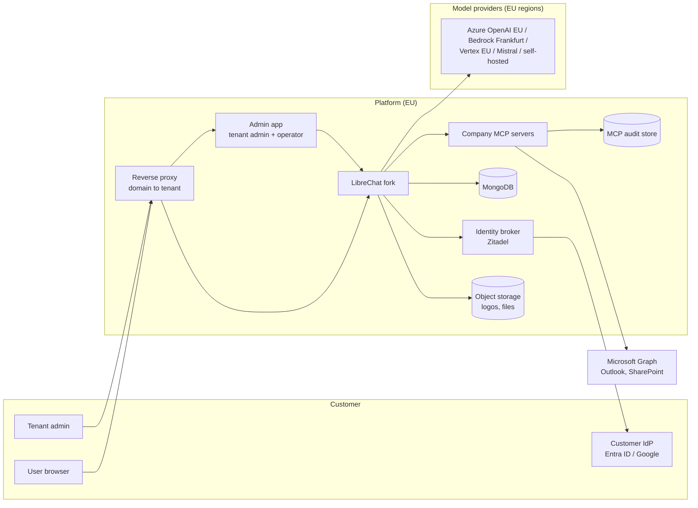
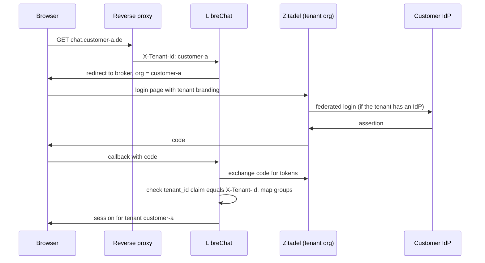
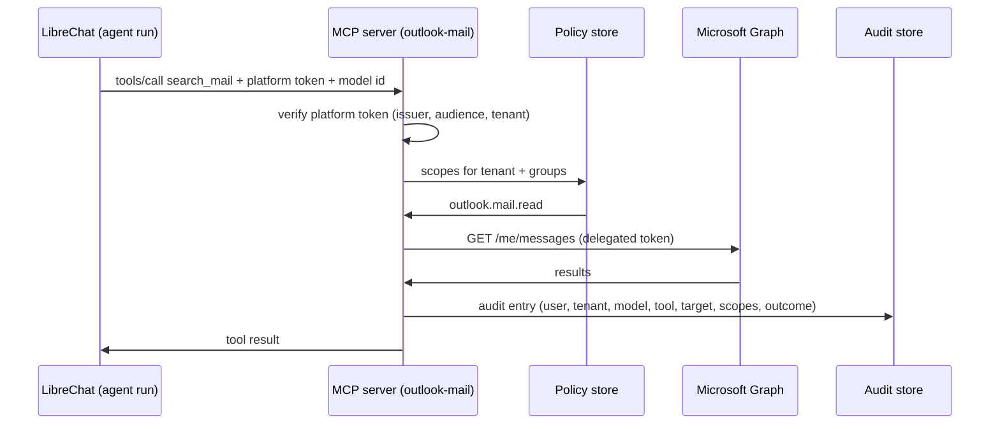
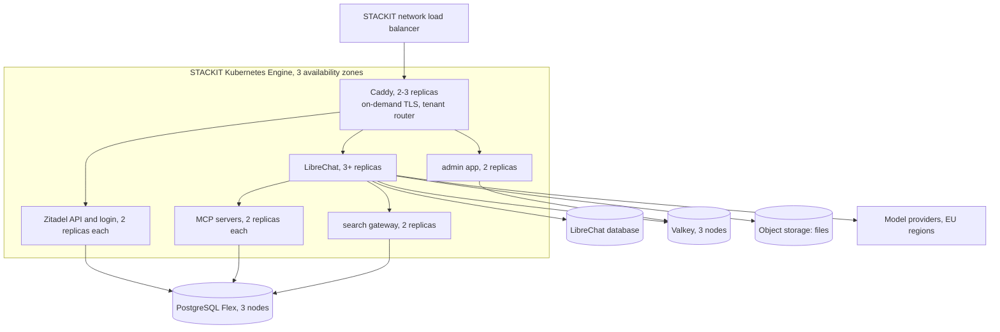

# Platform architecture

Status: draft, 2026-10-22. Fork-only document (`anno-systems/LibreChat`), not part of upstream.
It is the reference for all platform work across the repositories listed below. Change it when a
decision changes; record the change under [Decisions](#decisions).

## Product

A multi-tenant AI platform for companies, hosted entirely in Germany/the EU, with no lock-in to a
model vendor. Each customer (tenant) gets its own domain, login, branding, model selection, limits
and dashboards, administered by the customer's own admins. The differentiator is a set of
company-grade MCP servers: every tool call runs under a verified user identity, inside permission
scopes the tenant admin controls, and leaves an audit entry stating which model did what on behalf
of which user.

Principles:

- **EU residency is checkable.** Everything that stores or processes customer data, including the
  model endpoints, runs in the EU, and the tenant admin can see where each part runs.
- **The operator defines the catalog, tenants choose from it.** Models, providers and MCP servers
  are offered by the operator with region and price. Tenant admins enable and limit them; they do
  not add arbitrary endpoints (bring-your-own-key may come later as an explicit option).
- **Enforcement lives where the data is.** MCP servers check scopes and write their own audit trail.
  LibreChat passes identity; it is not the only line of defence.
- **The LibreChat fork stays thin.** New behaviour is additive and configurable; product code lives
  in its own repositories. See [Fork strategy](#fork-strategy).

## System overview

## Repositories

All repositories live in the `anno-systems` GitHub organization, are planned on one org-level
GitHub Project ("AI Platform"), and publish images to `ghcr.io/anno-systems/*`.

| Repository       | Contents                                                                                                                                     |
| ---------------- | -------------------------------------------------------------------------------------------------------------------------------------------- |
| `librechat`      | This fork. Tenant claim mapping, branding fields, MCP identity propagation, tool-call audit events, operator API module.                     |
| `admin-app`      | One admin application for tenant admins and the operator, built new. See [Admin app](#admin-app).                                            |
| `mcp-servers`    | Monorepo: a shared core (platform token check, scopes, audit writer, Microsoft OAuth, tenant settings) and one package and image per server. |
| `platform-infra` | Deployment: local Docker Compose stack, Terraform and Helm for STACKIT, reverse proxy, Zitadel configuration, per-tenant routing, backups.   |

## Tenancy

### What upstream provides

Verified in the code at `9008c47`:

- A tenant is an opaque `tenantId` string held in AsyncLocalStorage
  (`packages/data-schemas/src/config/tenantContext.ts`).
- A mongoose plugin filters every query and stamps every write with the tenant
  (`packages/data-schemas/src/models/plugins/tenantIsolation.ts`, rules in
  `packages/data-schemas/src/tenant/policy.ts`). About 45 collections are covered: users,
  conversations, messages, agents, MCP servers, groups, roles, config, balances, transactions,
  files and ACL entries among them. `TENANT_ISOLATION_STRICT=true` rejects requests without a
  tenant.
- After login the tenant comes from `user.tenantId` (`packages/api/src/middleware/tenant.ts`).
  Before login it comes only from the `X-Tenant-Id` header when `TRUST_TENANT_HEADER=true`
  (`packages/api/src/middleware/preAuthTenant.ts`). Upstream deliberately does no host or claim
  resolution.

### What we add

- **Tenant registry.** The Zitadel organizations are the registry: a tenant is an organization
  with the tenant id as its id, and the admin app's tenants are the organizations its service
  user belongs to. Suspension is the organization's state (deactivated), custom domains are the
  organization's metadata `chat_domains`. A `Tenant` record stored through a
  `packages/data-schemas` method follows only when plans or data-residency facts need data
  Zitadel does not hold.
- **Domain to tenant.** The reverse proxy strips any `X-Tenant-Id` and `X-Tenant-Origin` the
  client sent and asks the admin app's tenant router (`GET /internal/route`, Caddy
  `forward_auth`) which tenant the host is. The router answers from the registry, cached for
  30 seconds (an unknown host reloads it at most every 5 seconds, a failed reload keeps the last
  list): 200 with `X-Tenant-Id` for an active tenant, 403 with a short page for a suspended one,
  404 for a host that names no tenant. Platform subdomains follow the tenant URL template
  (`<tenant>.<platform domain>`); any other host is looked up among the custom domains, and the
  router then also sends `X-Tenant-Origin`, the domain's public origin. LibreChat trusts both
  headers only from the proxy (`TRUST_TENANT_HEADER=true`).
- **Custom domains** (2026-10-20). The operator sets up to ten domains per tenant in the admin
  app; a domain belongs to one tenant only and platform hosts are refused. Setting them adds the
  domains' callback URLs to LibreChat's OIDC app and to the tenant organization's domains. With
  `X-Tenant-Origin`, LibreChat uses that origin for the request's OpenID callback, redirects and
  `serverDomain` instead of the `TENANT_DOMAIN_*` templates
  (`packages/api/src/middleware/tenantOrigin.ts`). In production Caddy issues certificates on
  demand and asks the router first (`GET /internal/tls?domain=`), so it never requests one for a
  host that is not a tenant's domain. The customer points a CNAME at the platform.
- **Suspending and deleting a tenant** (2026-10-20). The operator suspends a tenant in the admin
  app, which deactivates its Zitadel organization: its users cannot sign in, the router answers
  403 on its hosts and its admins get `tenant_suspended`. Only a suspended tenant can be deleted,
  after the operator types its id. Deletion first purges LibreChat (`DELETE
/api/platform/tenants/:id`: every user is erased through upstream's erasure path, then every
  document with that `tenantId` except the append-only audit log, which records `tenant.purged`),
  then deletes the Zitadel organization. A failed purge stops before Zitadel, so it can be
  retried.
- **Claim to tenant.** At OIDC login, LibreChat takes the tenant from a claim in the broker's token
  and checks it against the header. A mismatch fails the login. This closes the gap where a user of
  tenant A logs in on tenant B's domain.
- **First admin.** Upstream only makes the first user of a tenantless deployment an admin
  (`api/server/services/AuthService.js`). Tenant admins are instead assigned by the operator when
  the tenant is created, or derived from a broker role.
- **Strict mode on.** Production runs with `TENANT_ISOLATION_STRICT=true`.

## Identity and login

Customers can log in through their own identity provider or with local accounts. Both run through
one identity broker, so LibreChat sees exactly one OIDC issuer.

- **Broker: Zitadel** (self-hosted in the EU). One Zitadel organization per tenant. Per
  organization: connected IdPs (Entra ID, Google Workspace, generic OIDC/SAML), local accounts with
  password reset and MFA, and login-page branding (logo, colors). Keycloak with one realm per tenant
  is the fallback if Zitadel falls short.
- **Organization id = tenant id.** Each tenant's Zitadel organization is created with the tenant
  id as its organization id (Zitadel accepts a caller-chosen id), so no mapping table is needed.
- **Token contents.** The ID token carries `sub`, `email` and Zitadel's resource-owner claims;
  `urn:zitadel:iam:user:resourceowner:id` is the user's organization, which is the tenant.
- **Group sync** (2026-10-20). At every sign-in through a tenant's identity provider, Zitadel
  calls the admin app (`/hooks/zitadel/idp-intent`, a signed Actions target). The admin app reads
  the provider's groups claim and stores `{ idp, groups }` as the user's Zitadel metadata
  `idp_groups`, so the next token carries the current groups. LibreChat, with
  `OPENID_GROUPS_CLAIM`, makes the user's memberships match that claim at each OpenID sign-in.
  Synced groups have source `oidc` and the id `<provider>:<group>`, so two providers of one
  tenant cannot collide and a sync never touches local groups. Missing groups are created, named
  after their id until an admin renames them. A failed sync is logged and the sign-in goes on.
- **Admins.** Tenant admins log in to the admin app through their tenant's organization. The
  operator logs in through a separate operator organization with mandatory MFA.

### Tenant-aware OpenID in the fork

Upstream builds the OpenID callback and redirects from the single `DOMAIN_SERVER` and
`DOMAIN_CLIENT`, and cannot ask the provider for a tenant's organization. The fork adds four
optional settings (`packages/api/src/auth/openid/tenant.ts`); unset, behaviour is upstream's:

| Variable               | Example                                                                                                                               | Effect                                                                                                                                |
| ---------------------- | ------------------------------------------------------------------------------------------------------------------------------------- | ------------------------------------------------------------------------------------------------------------------------------------- |
| `TENANT_DOMAIN_SERVER` | `https://{tenantid}.example.com`                                                                                                      | OpenID callback URL per tenant                                                                                                        |
| `TENANT_DOMAIN_CLIENT` | `https://{tenantid}.example.com`                                                                                                      | Redirect after login, failure, rate limit and ban                                                                                     |
| `OPENID_TENANT_SCOPE`  | `urn:zitadel:iam:org:id:{tenantid} urn:zitadel:iam:user:resourceowner urn:zitadel:iam:org:domain:primary:{tenantid}.auth.example.com` | Scopes added per tenant: log in to that organization, include the resource-owner claims, and let the login page find the organization |
| `OPENID_TENANT_CLAIM`  | `urn:zitadel:iam:user:resourceowner:id`                                                                                               | ID token claim that must equal the request tenant; otherwise the login fails before any user lookup                                   |

After login, `TENANT_HEADER_MATCH_USER=true` (with `TRUST_TENANT_HEADER=true`) makes every
authenticated request check that the user's tenant equals the proxy's `X-Tenant-Id`, so a session
of one tenant cannot be used through another tenant's hostname (403).

With `OPENID_REUSE_TOKENS=true`, which MCP token forwarding needs, LibreChat authenticates
requests with the provider's own token (`openidJwt` strategy). Upstream looks that user up before
any tenant context exists, so strict isolation answers 500 on every authenticated route. The
fork runs that lookup in the proxy's tenant and applies `OPENID_TENANT_CLAIM` to the bearer
token as well, so a token of tenant A sent through tenant B's hostname gets 401.

Tenant admins use LibreChat's own admin login (`/api/admin/oauth/openid`), which the fork makes
tenant-aware like the user login: the tenant's own callback, its organization scope and the
claim check. Zitadel's project role `tenant-admin`, granted per tenant organization, makes a
user a LibreChat admin of that tenant (`OPENID_ADMIN_ROLE=tenant-admin`,
`OPENID_ADMIN_ROLE_PARAMETER_PATH=urn:zitadel:iam:org:project:roles`). Upstream's admin login
accepts only users who already exist, so a new admin signs in to the chat once first.

These are environment variables like the rest of upstream's OpenID settings, which all live in
the environment rather than `librechat.yaml`. Zitadel's login UI does not itself stop a user of
another organization from signing in; the claim check is what rejects that login (verified
end to end in `platform-infra`).

Zitadel's login app reads the organization from `urn:zitadel:iam:org:id:` only when the id is
numeric, and our organization ids are the tenant ids. Without more, the login page therefore runs
in the default organization: no tenant branding and none of the tenant's identity providers
(the claim check is unaffected, because Zitadel's core applies the scope). Each tenant
organization therefore has the primary domain `<tenant>.<auth host>`, and the tenant scope also
names it with `urn:zitadel:iam:org:domain:primary:`, which the login page resolves. With the
organization known, users sign in with their email address (2026-10-20).

### Single sign-on per tenant

A tenant admin connects the company's identity provider (Microsoft Entra ID or any OpenID
Connect provider) in the admin app. The admin app creates the provider as a template in the
tenant's Zitadel organization, gives the organization its own login policy and activates the
provider there, so it appears on that tenant's sign-in page only. It acts with one Zitadel
service user that holds `ORG_SETTINGS_MANAGER` and `ORG_USER_MANAGER` in each tenant organization and nothing else
(platform-infra's provisioner), always naming the session's organization. Client secrets go to
Zitadel only. Issuers must be HTTPS on a public host name, because Zitadel fetches their
discovery document; an egress policy for Zitadel is what fully prevents a public name resolving
to a private address.

## Configuration and model catalog

Upstream already resolves configuration in layers: the YAML file, then a tenant base document,
then group, role and user documents by priority (`packages/data-schemas/src/app/resolution.ts`,
`packages/api/src/app/service.ts`). Endpoints, model lists, model specs, interface settings,
balance and remote MCP servers can all be overridden per layer.

The platform builds on that instead of inventing a second config system:

| Layer                | Who sets it                      | Contents                                                                                                               |
| -------------------- | -------------------------------- | ---------------------------------------------------------------------------------------------------------------------- |
| `librechat.yaml`     | Operator, at deploy              | The full catalog: every provider endpoint with keys, region and price; locked sections (`filters`, stdio MCP servers). |
| Tenant base document | Operator (plan) and tenant admin | Which catalog entries the tenant may use, default model, balance policy, theme, branding.                              |
| Group documents      | Tenant admin                     | Narrower model sets, greeting and credit limits per group.                                                             |
| User documents       | Tenant admin (rare)              | Exceptions.                                                                                                            |

Models and settings per group (2026-10-20): upstream has no "model" permission, so "group X
may use model Y" is a group config document that narrows the tenant's model lists, written by
the admin app's groups screen together with the group's greeting and credit limits. Groups are
the synced ones (members from the identity provider) and the tenant's own (members added in the
admin app). The groups with settings form an ordered list whose order sets the documents'
priorities, so for someone in several groups the group higher in the list wins.

### Catalog per tenant

The YAML catalog is the same for every tenant. The fork adds a catalog per tenant
(`packages/api/src/platform/catalog.ts`, `packages/data-schemas/src/methods/platformCatalog.ts`),
active with `ADMIN_CONFIG_CATALOG_LOCK=true` (2026-10-20):

- **Platform providers.** The operator keeps providers (base URL, encrypted key, models) in
  LibreChat and assigns each tenant providers and a subset of their models. The operator API
  (`/api/platform/*`) is reachable only with `PLATFORM_API_TOKEN` from the admin app's server,
  is off (404) without a token of at least 32 characters, and is blocked at the proxy.
- **Own providers (BYOK).** A tenant admin adds up to ten providers with their own key
  (`/api/admin/catalog`). The base URL must be HTTPS and pass the SSRF check; names may not
  shadow a platform provider.
- LibreChat adds the tenant's endpoints to the base config before the tenant's documents are
  applied, reloading them at most every 30 seconds, so the existing narrowing and the per-group
  documents work on them unchanged. Keys never leave the server: `/api/endpoints`,
  `/api/models` and `/api/config` show names, models, model labels, model vendors and the
  provider's label and location only.

### Catalog models (2026-10-30)

Owner's decisions on the shape of a platform provider (`packages/data-schemas/src/methods/platformCatalog.ts`,
`packages/api/src/platform/models.ts`):

- **One display name.** `label` is the only user-facing name and can change at any time. The id
  (`name`, the endpoint name everything else refers to) is fixed at creation: `POST
  /api/platform/providers` derives it from the label as a slug (`Mistral (Paris)` →
  `mistral-paris`) unique, case-insensitively, among providers, `librechat.yaml` endpoints and
  every tenant's own endpoints (a provider may later reach that tenant), appending `-2`, `-3` on
  a collision; API clients may still pass an explicit `name`, checked the same way. A tenant's
  own endpoint in turn may not take a provider's or a YAML endpoint's name. `PUT /providers/:name` updates (and,
  for older clients, still creates under an exact name).
- **Models are objects**: `{ id, label?, location?, limits? }`. `id` is the API model name;
  `label` is shown in the model selector (the endpoint's `modelLabels`, which the client reads
  for custom endpoints) and in migration notices.
- **Location** replaces `region` (dropped) and `country`: `{ type: 'country', code }` (ISO
  3166-1 alpha-2), `{ type: 'eu' }` or `{ type: 'global' }`. The provider's default is required
  on every write (400 `location_required`; a provider migrated without a `country` is served
  without one until its next save, where the admin app asks for it), a model may override it, and tenant admins get the effective location per model in
  `/api/admin/catalog` (flag, EU badge or globe in the admin app). A tenant's own (BYOK)
  endpoints take the same model and location shape, without limits, and may leave the location
  out.
- **Limits per model** (see [Provider limits](#provider-limits-and-the-wait-queue-2026-10-26)):
  the provider-wide limits are gone; the queue settings (`queue.maxWaitSeconds`,
  `queue.pauseSeconds`) stay on the provider because they describe how a user waits, not a
  capacity.
- **Migration.** Documents of the older shape (string models, `region`, `country`, provider-wide
  `limits`) are read in the new shape everywhere, and an idempotent pass at startup
  (`migratePlatformCatalog`) rewrites them: string models become `{ id }`, `country` becomes a
  country location, `region` is dropped, and the provider's limits are copied to each model
  (which multiplies capacity, accepted by the owner) with `maxWaitSeconds`/`pauseSeconds` moved
  to `queue`. The collections are small (tens of providers, one catalog per tenant), so one pass
  is cheap, and reads stay reads: a lazy write-back would turn the 30-second catalog reload of
  every tenant into writes. A write only applies to the document as read, so an operator's save
  in between wins. During a rolling deploy an older replica still running reads the rewritten
  providers without their models until it stops.

### Vendor groups in the model selector (2026-10-30)

A catalog provider is an account (key, limits, location), and one Azure AI Foundry account serves
Mistral, OpenAI and Anthropic models, so grouping the selector by provider showed one group
"azure-anno-systems-westeurope" (the internal name) with every maker's models. Owner's decisions
(`packages/data-provider/src/vendors.ts`, `packages/api/src/platform/catalog.ts`,
`client/src/components/Chat/Menus/Endpoints/vendors.ts`):

- **Grouped by vendor.** The chat model selector shows the models of catalog endpoints (platform
  providers and tenant BYOK endpoints) under their vendor: Mistral, OpenAI, Anthropic, Google,
  Meta, DeepSeek, xAI, Cohere, Qwen, in that order, whichever account a model runs through.
  Models of no known vendor (`other`) stay in a group named by the provider's label. The
  built-in endpoints that call one vendor directly (`openAI`, `anthropic`, `google`;
  `builtinEndpointVendors`) join that vendor's group with the hosting line "OpenAI direct"
  ("OpenAI direkt"), so there is one group per vendor; one that needs the user's own key keeps
  its row, where the key is set. Azure OpenAI (which also serves other makers' models), Bedrock,
  assistants, YAML custom endpoints without catalog info and "My Agents" keep their rows, and the
  vendor groups stand where the first grouped endpoint stood. Model specs whose `group` names a
  grouped endpoint get a group headed by the endpoint's label. Selecting a model still stores
  its real endpoint and model, so conversations, agents, migrations, queues and prices are
  untouched. Search matches the vendor's name, the model's label and id and the provider's
  label, and shows matches by vendor.
- **Agent editor.** The agent builder's pickers (`vendorChoices.ts`, same grouping functions)
  list vendor groups and the other providers first, then a group's models across endpoints, each
  with its hosting line; the agent still stores provider and model.
- **Vendor per model.** Catalog models have an optional `vendor` (one of the registry's ids,
  including `other`) that the operator may set; without one it is detected from the id,
  case-insensitively and without a `vendor/` prefix (`mistral*`, `mixtral*`, `codestral*`,
  `devstral*`, `magistral*`, `pixtral*`, `ministral*`, `voxtral*`, `mathstral*` → Mistral;
  `gpt*`, `o<digit>*`, `chatgpt*` → OpenAI; `claude*` → Anthropic; `gemini*`, `gemma*` → Google;
  `llama*`, `meta-llama*` → Meta; `deepseek*`; `grok*` → xAI; `command*` → Cohere; `qwen*`).
  Only the operator's choice is stored, so stored documents need no migration and later rules
  reach them. Operator and tenant admin responses always carry `vendor`. The registry (id, name,
  icon) lives in `packages/data-provider` for client and server; icons are the client's provider
  icons.
- **Hosting under each model.** Each catalog model row has a second line with the provider's
  label and the model's effective location: "Azure · Global", "Mistral (Paris) · 🇫🇷 France"
  (flag and the country's name in the user's language), "… · EU".
- **Names from ids.** A model without a `label` is shown with a name derived from its id
  (`suggestModelLabel`: `mistral-medium-3-5` → "Mistral Medium 3.5", `gpt-6.1-terra` → "GPT-6.1
  Terra", `claude-sonnet-5-5` → "Claude Sonnet 5.5", `Mistral-Large-3` → "Mistral Large 3",
  `claude-3-5-sonnet-20241022` → "Claude 3.5 Sonnet"): vendors' spellings (GPT, Claude, Gemini,
  Llama, DeepSeek), the o-series lower case ("o4-mini"), two short numbers in a row as one
  version anywhere, a trailing snapshot date (`YYYYMMDD`) dropped, ISO dates (`2024-08-06`)
  kept. The grouped built-in endpoints' models get derived names too ("GPT-4o"), unless the
  deployment set a label; the agent editor's summary button shows the same name. An explicit `label` always
  wins. The name is the endpoint's `modelLabels` entry (so the selector and migration notices
  use it) and is shown read-only as `suggestedLabel` in the operator and tenant admin APIs, for
  the admin app's placeholder.
- **No extra request.** `/api/endpoints` carries, per catalog endpoint, `modelVendors` (model →
  vendor), `hosting` (`{ label, location? }`) and `modelLocations` (models whose location differs
  from the provider's), next to `modelLabels`; no URLs or keys. `modelVendors` marks the endpoint
  as a catalog endpoint, and the selector names such an endpoint by `hosting.label`.

### Model URLs, APIs and keys (2026-10-30)

The owner's models sit on one Azure AI Foundry resource with one key but answer at different
URLs and through different APIs (Mistral and Mistral Large through Chat Completions, GPT-6.1
through the Responses API, Claude through the Anthropic Messages API). Owner's decisions
(`packages/api/src/platform/models.ts`, `params.ts`, `catalog.ts`):

- **The provider is the account** (label, key, location, queue, `allTenants`); **each model has
  its own `baseURL` and `api`**: `chat` (OpenAI Chat Completions), `responses` (OpenAI Responses
  API) or `anthropic` (Anthropic Messages API). The model's `baseURL` falls back to the
  provider's, which is optional now (a model without either is refused, 400
  `base_url_required`).
- **Pasted URLs.** The operator pastes what the portal shows. Query and trailing slashes are
  removed, and a trailing `/chat/completions`, `/responses` or `/messages` is stripped and names
  the model's `api` when none is given (a model without its own URL takes the API the provider
  URL's ending named; a URL without such an ending names none, which is served as `chat`).
  `…/anthropic/v1/messages` is stored as `…/anthropic/v1`; the Anthropic client, which appends
  `/v1/messages` itself, is given `…/anthropic`.
- **One endpoint, a route per model** (chosen over one internal endpoint per URL and API, which
  would have split the provider in the selector and changed the endpoint name that assignments,
  conversations, agents, model migrations, queues and prices refer to, so moving a model to
  another API would have needed a migration). The custom endpoint schema has a fork field
  `modelRoutes` (model id → `baseURL`, `provider: anthropic`, `addParams`, `dropParams`), and
  every place that builds a request for a model resolves the endpoint with that model
  (`withModelRoute` through `getCustomEndpointConfig` and `getProviderConfig`, used by
  `initializeCustom` for chats, titles and activity labels, by `initializeAgent` and by
  summarization). `responses` is upstream's `useResponsesApi` on the OpenAI client; `anthropic`
  is upstream's `provider: anthropic` for custom endpoints (native client, key as `x-api-key`,
  which Azure AI Foundry accepts; the OpenAI APIs take it as a bearer token, which Azure's v1 API
  accepts too).
- **Parameters follow the model's API.** `/api/endpoints` names the parameter set of each model
  routed through another API than its endpoint (`modelParamsEndpoints`, no URLs or keys), and the
  client's parameter panels, the agent builder and settings parsing take it
  (`getDefaultParamsEndpoint` with the model), so Claude shows Anthropic's parameters next to
  Mistral's OpenAI ones in one provider. Before a request leaves, a routed model's settings lose
  the fields its API does not take (`withoutForeignParams`, from the OpenAI and Anthropic
  conversation schemas plus raw OpenAI fields): the Anthropic API never gets
  `frequency_penalty`, `presence_penalty`, `logit_bias`, `n` or other OpenAI-only fields, and the
  OpenAI APIs never get `topK`, `topP` (Anthropic's spelling), thinking settings or prompt
  caching. A conversation moved between the provider's models therefore keeps working.
- **Rejected request fields are built-in rules** per API and model family (`params.ts`), not an
  operator list: `user` is never sent on the OpenAI APIs (Mistral and other Foundry models reject
  it), reasoning models (`o1`…`o9`, `gpt-5`, `gpt-6` and later, not `-chat`) get no sampling
  controls, and the Anthropic API gets no `metadata` (the user id). The token limit field needs
  no rule: upstream sends `max_completion_tokens`/`max_output_tokens` for `gpt-5` and later, the
  OpenAI client does it for `o`-series models. A model may override the rules with its own
  `dropParams` (an advanced field; the operator API shows the rules as `defaultDropParams`). A
  provider that still has the operator's `dropParams` from before keeps it until the operator
  sends `dropParams: null`, which the admin app does on every save, so providers move to the
  rules.
- **A provider without a key.** A seed creates providers and the owner adds keys in the admin
  app, so `POST /api/platform/providers` may leave out `apiKey`. Such a provider is listed to the
  operator with `keyMissing: true`, can be assigned, and is served to no tenant (no endpoint,
  not in `/api/admin/catalog`, no platform agent run) until a key is set. An update without
  `apiKey` keeps the stored key, as before. Its models are no migration target: a successor in
  `successors`, an operator migration or a tenant migration that names one is refused with 400
  `target_not_served` (a successor on the provider being saved is allowed when that save sets
  the key).
- **Migration.** None needed: a stored model without `api` is `chat`, without `baseURL` it uses
  the provider's, and old documents keep their provider-wide `dropParams`.

### Catalog lock

Tenant admins are LibreChat admins of their tenant and can call `/api/admin/config` with their
own token, not only through the admin app. Upstream lets such a write set any endpoint field and
resolves `${NAME}` references from the server's environment at request time. A tenant admin could
therefore point a catalog endpoint's `baseURL` at their own server and receive the operator's
provider key, or set a web search key to `${JWT_SECRET}` or another tenant's search key (the web
search path does not apply upstream's sensitive-variable denylist).

`ADMIN_CONFIG_CATALOG_LOCK=true` (fork, `packages/api/src/admin/catalogLock.ts`) closes that:

- `endpoints` writes may only name a custom endpoint from `librechat.yaml` and set
  `models.default` to a subset of its catalog list. Every other endpoint field and section is
  refused, as are endpoints the catalog does not have.
- No written value may contain `${…}`. Operator-owned references such as the web search key live
  in `librechat.yaml`, not in tenant documents.

LibreChat enforces the resulting list on every chat request (`validateAgentModel`, a model outside
the list fails with `illegal_model_request`), so the narrowing is a real limit, not a UI filter.
Catalog endpoints must list their models (`fetch: false`); a fetched list would replace the
narrowing. The lock is an environment switch rather than a `librechat.yaml` field so it is never
writable through the API it guards.

### Platform agents

Some agents belong to the platform, not to a tenant: the support agent first (2026-10-26). The
operator defines them in the admin app's operator area (`/api/platform/agents`): name,
description, instructions, conversation starters, tools (the tools the platform's MCP servers
registered, `/api/platform/agents/tools`, such as the `support` server's), a model of a platform
provider, and the tenants, all (also ones created later) or
listed ones (`packages/api/src/platform/agents.ts`, `PlatformAgent` in
`packages/data-schemas/src/methods/platformAgent.ts`, platform-wide like providers and banners).

- **A copy per tenant.** Each targeted tenant gets an ordinary agent of its own with
  `platformAgentId` set (`agent_<platformAgentId>`, no author) and upstream's viewer grant for
  everyone in the tenant, so the chat, the agent list, favorites, usage per agent and the
  model selector need nothing new. Copies are written when the operator saves or deletes a
  definition and when a tenant admin switches one; a tenant created later gets its copies the
  first time its agents are listed (at most every 30 seconds per replica).
- **Tenant admins switch, nothing else** (owner's decision). `/api/admin/platform-agents` lists
  the platform agents meant for the tenant and switches one on or off (`manage:agents`); off
  deletes the tenant's copy, on writes it again with the same id, so favorites come back.
- **Locked for everyone else.** A LibreChat admin's `manage:agents` bypasses agent ACLs, so
  sharing rights alone cannot protect a copy. Every route that changes an agent, its files,
  actions, avatar, versions or sharing answers 403 `platform_agent_locked` for a copy, whoever
  calls; behind them, data-schemas' `platformAgentLock` makes any other agent update or delete
  match no copy and refuses to save a document claiming to be one. The chat's builder shows a
  copy read-only. Erasing a tenant still deletes its copies.
- **Provider without assignment, billed to the tenant.** A run of a copy adds its catalog
  provider as a custom endpoint of that run's config, and its model to the models the run
  validates against, without touching the tenant's endpoint and model lists
  (`prepareRun`, called in `api/server/services/Endpoints/agents/initialize.js`). The endpoint
  is built like the tenant catalog's, so tokens are priced at the provider's rates, and the
  transactions are written in the tenant's context, where the platform markup applies. Only the
  current copy of a definition that targets the tenant and runs on that provider and model gets
  the endpoint. A provider a platform agent runs on cannot be deleted
  (`provider_used_by_agents`).
- **Not covered yet.** A platform agent as a handoff or subagent target of a tenant's agent, in
  the multi-conversation view and on the OpenAI-compatible agents API still needs the tenant's
  assignment of its provider.

### Model migration (2026-10-30)

Operators retire catalog models and add new ones; tenant admins switch older models off before
that. Everything that still named the old model broke. A model migration (owner's decision)
maps (endpoint, model) to (endpoint, model) and does two things
(`packages/api/src/migration/`, `packages/data-schemas/src/methods/modelMigration.ts`):

- **Rewrite, once.** Agents (`provider`, `model`; version history stays history), conversations
  (`endpoint`, `model`, `endpointType`), presets, model spec presets in config documents (tenant,
  group, role and user, `configVersion` bumped) and model favorites of users (a pin of the old
  model is dropped when the successor is already pinned) are moved to the successor, in batches
  of `_id`s per kind, scoped to the tenant for a tenant migration. When a redirect already
  continues from the successor (A→B while B→C exists), documents go straight to the end of the
  chain, and redirects of the same scope that ended at the old model are pointed there too.
  Running the same mapping again changes nothing. Messages keep the model they were written
  with. Platform agent copies are left to their definition. Merged configs and cached auth
  documents of changed users are invalidated.
- **Successor enabled (owner's decision).** An operator migration enables the successor for each
  tenant that had the old model, with the same grants: it is added to the narrowed lists of the
  tenant's base, group and role documents that offered the old model (a document that does not
  narrow the successor's endpoint, while the base document does, gets the base list plus the
  successor), and to the tenant's catalog assignment when the successor's provider is assigned
  per tenant. Tenants without the old model are not touched. Recorded in `model.migrated`
  (`successorConfigs`, `successorAssigned`).
- **Redirect, kept.** The mapping stays as a platform-wide document (scope `platform`, for every
  or listed tenants, or a tenant's id), held in memory and reloaded every 30 seconds per
  replica. Chat requests (`routes/agents/chat.js`), every agent of a run before its model is
  validated (primary, handoff, subagents, added conversation) and model spec presets in the
  served config go to the successor. At each step the tenant's redirect wins, then the
  operator's for listed tenants, then the operator's for all; chains are followed and a step
  back to a model already passed ends the chain.
- **Notice.** A migrated conversation and agent carry `modelMigration: { id, from, to, at }`, where
  `from` and `to` hold `endpoint`, `model` and, when known, `label` (the display name given with
  the migration or a model spec's label, stored at migration time so a retired model keeps its
  name). The chat shows "Now runs on Mistral Large 3 instead of Mistral Large 2" (the model id
  without a label) once above the composer. A conversation's notice is its owner's; a migrated
  agent's notice is shown once to each user, on any chat with the agent (new ones too) and in
  its builder, for 30 days after the migration. Acknowledgements are rows per (migration, user)
  in `ModelMigrationSeen`, kept 90 days, so shared agents scale. Every migration is recorded as
  `model.migrated` in each affected tenant's audit chain (and the platform chain for the
  operator's), with counts per kind.
- **Who.** The operator through `/api/platform/model-migrations` (target: a model of the
  catalog); tenant admins through `/api/admin/models/migrations` (`manage:configs`; target: a
  model enabled in the tenant-wide config). Both have a preview with counts per kind and a usage
  count per model, over active chats only (neither archived nor temporary); the rewrite moves
  all of them.
- **Successor mandatory.** A provider update or tenant assignment that drops a model agents or
  conversations still use is refused with 409 `model_in_use`, unless a redirect covers it or the
  same call names `successors`, which are migrated before the write. A model a platform agent
  runs on cannot be dropped (`model_used_by_platform_agents`). For tenant admins the admin app
  asks for a successor before saving a narrowing, using the usage count.
- **Restricted to groups (owner's decision).** A tenant admin may restrict a model from everyone
  to some groups; users outside them lose it, members keep it. The admin's migration, preview
  and usage count (`/api/admin/models/migrations`, `…/migrations/preview`, `…/usage`) take
  `exceptGroups` (1–100 group ids of the caller's tenant; any other id is 400 `unknown_group`
  with the offending `groupIds`). Members are resolved at run time from the groups' `memberIds`
  the way `getUserPrincipals` does (a user's `idOnTheSource`, else its id). The rewrite then
  covers only what non-members own: agents by `author`, conversations and presets by `user`,
  favorites by user. Model specs in config documents are not touched, because the config
  applies to the members too, and no redirect is stored, because the old model stays valid for
  them. `migration.id` is still an `mm_` id, which names the run in notices and the audit
  (`model.migrated` with `exceptGroups`, `exceptedUsers`, `redirect: false`) but no redirect;
  the response carries `exceptGroups`. Accepted for now: an agent authored by a member but
  shared with the whole tenant is not rewritten, so users outside the groups fail on it until
  its author moves it; membership changes after the run are not followed.

## Admin app

One application serves both tenant admins and the operator, so there is one codebase, one design
system and one deployment. It is built new rather than forked: the official
[ClickHouse/librechat-admin-panel](https://github.com/ClickHouse/librechat-admin-panel) is licensed
AGPL-3.0, which would oblige us to publish the source of our modified version to every user of it
over the network, while LibreChat itself is MIT. The new app is written clean-room: it uses
upstream's documented `/api/admin/*` API but copies no code from the AGPL panel.

| Area          | Who sees it                                | Backend                                                                | Functions                                                                                                                                                                   |
| ------------- | ------------------------------------------ | ---------------------------------------------------------------------- | --------------------------------------------------------------------------------------------------------------------------------------------------------------------------- |
| Tenant area   | Tenant admins, limited to their own tenant | Upstream `/api/admin/*` in the tenant's context, extended where needed | Users and groups, models per group, agents, enabling MCP servers and assigning scopes, branding, budgets, usage dashboards, audit viewer, SSO                               |
| Operator area | The operator only                          | New operator API module in the fork                                    | Create, suspend and delete tenants; domains; Zitadel organization; plans; model catalog with regions and prices; MCP catalog; health; cross-tenant usage and billing export |

Built so far (2026-10-20), in the tenant area:

| Function            | Backend                                                                                                               |
| ------------------- | --------------------------------------------------------------------------------------------------------------------- |
| Greeting            | `interface.customWelcome` in the tenant's base document                                                               |
| Features            | `USE` of role permissions (agents, web search, file search, MCP, skills, memory, code, prompts, bookmarks …)          |
| Models              | Narrowing of the YAML catalog in the base document, under the catalog lock                                            |
| Agents for everyone | Upstream's public viewer grant on an agent (`/api/permissions/agent/:id`), kept inside the tenant by isolation        |
| Platform agents     | On or off per tenant (`/api/admin/platform-agents`); see [Platform agents](#platform-agents)                          |
| User limits         | `balance.*` in the base document; one user's credits through the fork's `/api/admin/users/:id/balance`                |
| Web search usage    | The search gateway's usage report, asked for the session's tenant only                                                |
| Single sign-on      | Identity providers in the tenant's Zitadel organization (see [Single sign-on per tenant](#single-sign-on-per-tenant)) |
| Users               | Upstream's user list and admin erasure (`ADMIN_USER_DELETION`)                                                        |
| Invitations         | An account without a password in the tenant's Zitadel organization and Zitadel's invite email                         |

And in the operator area, on `/operator` of the same app: **create a tenant**. The operator signs
in to Zitadel with the admin app's own OIDC client (operator role of the platform organization,
second factor required). With an operator service user (`IAM_ORG_MANAGER`, `ORG_OWNER` of the
platform organization) the admin app creates the organization with the tenant id, its primary
domain and branding, grants it LibreChat's project, adds the admin app's service user, adds the
tenant's callback URLs to LibreChat's OIDC app and invites the first admin with `tenant-admin`.
A failed step undoes the ones before it. LibreChat itself needs nothing per tenant. The operator
area also suspends, reactivates and deletes tenants, sets their custom domains, keeps the
platform providers of the tenant catalog and the platform agents. Missing: plans.

The admin app keeps LibreChat's admin token on its server and refreshes it about a minute before
`SESSION_EXPIRY` through upstream's `/api/admin/oauth/refresh`. Agents and their permissions live
on LibreChat's user-facing API, which bans clients that are not browsers by user and IP; those
calls forward the admin's own browser user agent. Every call also carries the admin's own address
in `X-Forwarded-For`, which LibreChat trusts from its first hop (`TRUST_PROXY`), so LibreChat's
per-IP login and refresh limits (`LOGIN_MAX`), its violation bans and its audit entries apply to
each admin, not to the admin app's single address.

Decision: limits and bans stay per admin address, not per tenant. A tenant-keyed limit would let
one admin's failures, or an attacker who knows a tenant's id, lock out every admin of that
tenant; a per-address limit confines that to the address that misbehaves.

Separation rules, because one app now holds both:

- The operator area is enforced by the backend, not by hiding menu items. The operator API accepts
  only operator tokens from the operator organization, with MFA.
- The operator area is served only on the operator hostname (for example
  `admin.<platform-domain>`); on customer domains the app shows the tenant area only.
- The operator API works across tenants (`runAsSystem`), so it is the most sensitive surface in
  the system: every call is written to the audit log.

## Branding

Tenant admins brand their tenant in the admin app (2026-10-20). The fork adds
`interface.branding` (`packages/data-provider/src/branding.ts`): app title, logo, favicon and
footer, unset by default so upstream's look stays. Images are HTTPS URLs or small data URLs
(PNG, JPEG, WebP, GIF, SVG or ICO, at most 128 KB) stored in the tenant's base document, so no
object storage is needed yet. Title and logo reach the sign-in page before login; the footer
only after it. The accent color is upstream's `interface.theme` with a `tenant-accent` theme.

The same save brands the Zitadel login page of the tenant's organization (label policy, logo
and icon assets). Zitadel's login app caches branding for an hour by default; the stack lowers
that to five minutes (`API_CACHE_CONFIG`).

### Deleting a user (data protection)

A tenant admin erases a user in the admin app. It calls upstream's admin erasure handler, which
the fork routes behind `ADMIN_USER_DELETION=true` (`DELETE /api/admin/users/:id`): it stops the
user's generations and schedules and deletes conversations, messages, files, memories, own
agents, shares, sessions and settings, inside the admin's tenant only.

The admin app also deletes the user's Zitadel account. It finds the account by the user's email
address inside the tenant's organization and deactivates it first, so the user cannot sign in
during the erasure. LibreChat then erases the data, and the app deletes the account. A refused
erasure reactivates the account. Several accounts with the address stop the deletion before
anything changes. An account Zitadel fails to delete stays deactivated, and the admin is told to
ask the operator. The admin app's service user is `ORG_USER_MANAGER` in each tenant organization
for this.

Still open: pseudonymizing the user in the MCP audit logs (the subject is replaced by a keyed
pseudonym whose key is deleted, so the hash chain stays valid).

## Usage, limits and dashboards

Web search usage per tenant comes from the search gateway's `search_usage` table
(`GET /usage?month=YYYY-MM`, operator token); see the decision below.

Upstream provides a per-user balance with refill (`packages/data-schemas/src/schema/balance.ts`)
and a transaction per model call with user, model, tokens and tenant
(`packages/data-schemas/src/schema/transaction.ts`). Balance policy can already differ per tenant
and group.

Tenant admins set the user limits in the admin app (2026-10-20): the tenant's balance policy is
`balance.*` in its base document (start balance, automatic refill), and a user's own balance is
read and set through the fork's `GET`/`PUT /api/admin/users/:id/balance`, which upstream only
offers as a CLI script. A user at zero credits is refused with `token_balance` until the balance
is raised or refilled. Every set is in the admin audit log (`user.balance_updated`).

### Prices and margin (2026-10-25)

The platform charges its tenants a markup on the providers' token prices and a price per web
search. The operator sets both in the operator area (`/api/platform/pricing`): a platform default
(at launch 15 % on tokens, 2 EUR per 1,000 searches), an override per tenant for discounts, and
the display currency with a fixed USD rate. Decisions:

- **The markup is charged, not only shown.** It scales every model rate where LibreChat resolves
  rates (`withTokenMarkup` around `getMultiplier`, `packages/data-schemas/src/methods/platformPricing.ts`),
  so balances, the balance check, the cost shown in chat and the admin price list all carry the
  same price. The ledger keeps USD-based credits; a transaction's `rate` is the charged rate.
- **Searches are charged to the user's balance**: each completed `web_search` writes one ledger
  transaction of context `web_search` (`packages/api/src/platform/searchCharge.ts`). The search
  gateway stays the meter of record per tenant and enforces the monthly quota.
- **EUR with a rate the operator sets**, not a daily exchange rate, so a tenant's prices do not
  move from day to day. The rate goes to the client as `interface.currency`.
- **Tenant admins see what they spent** (`GET /api/admin/usage/costs`, per day, calendar month,
  model, user and group) and their price list (`/api/admin/usage/pricing`), always at their own
  prices; the markup and the providers' prices are never shown to them. Per-user and per-group
  costs need `read:users` as well as `read:usage`, since they name people.
- Open: the ledger does not record the markup per transaction, so the operator's margin per period
  is derived from the current markup; record it per transaction before the first invoice run if a
  markup changes mid-period.

### Page fetches per search (2026-10-30)

Serper bills a page fetch (scrape) at twice a search, and LibreChat's search tool fetches up to 5
pages per search (plus 5 top stories for news), so one search could cost the platform 11 credits
while the tenant paid for one search. Decisions:

- **Page fetches have their own price**, `fetchPer1000` next to `searchPer1000`, as default and per
  tenant. Each page the gateway let through is one ledger transaction of context `web_scrape`,
  including pages that returned no text; refused pages are not charged. The tool's artifact cannot
  tell a fetched page from a refused one (the tool strips each source's highlights and content), so
  LibreChat counts the pages the tool attempted, as the tool picks them (the first 5 distinct
  results and, for a news call, up to 5 top stories that are no result), and charges the smaller of
  that and the page limit, which is exactly what the gateway lets through. A page that failed at
  Serper after the gateway let it through is charged too. Tenant costs report `fetchCredits` and
  `fetches` apart from searches. Without a price, fetches cost nothing.
- **The operator caps the pages per search** (`maxPagesPerSearch`, 0 to 10, default 5) as default
  and per tenant; a tenant admin can only go lower (`webSearch.maxPagesPerSearch` in the tenant's
  config, the only `webSearch` field the catalog lock lets tenants write). **A call that searches
  news gets twice the limit**, in the gateway and in the charge (LibreChat reads `news` from the
  tool call's arguments; the gateway sees the call's search of category `news`).
- **The search gateway enforces it**, because the search tool cannot be told: LibreChat sends a
  run id and the page limit in the gateway key (`{{LIBRECHAT_SEARCH_RUN}}`,
  `{{LIBRECHAT_SEARCH_PAGES}}`). Each search starts a fresh budget for its run (twice the limit for
  a news search; the web and news searches of one call, sent together before any fetch, keep the
  larger budget), and fetches over it are refused before Serper and not metered. Budgets are rows
  in the gateway's PostgreSQL (`search_page_budgets`, tenant and run, remaining pages and expiry,
  10 minutes), so every replica shares them; queries and URLs are never stored.

### MCP server prices (2026-10-27)

Tenants pay a fixed monthly price for each platform MCP server they use, for example 20 EUR per
tenant and server. The operator sets it in the operator area's Prices page
(`/api/platform/mcp-pricing`); no price, or 0, means free. Decisions:

- **Consent to the price shown.** Switching a priced server on in the admin app's AI tools needs
  the tenant admin's explicit consent to the price (a toggle in the server's dialog). The admin
  app sends the price it showed; LibreChat answers 409 `price_changed` when that is no longer the
  current price. Each consent is a subscription (`McpSubscription`, tenant-isolated): server,
  accepted price and currency, who accepted and when, and the periods it was on. Subscribing and
  ending a subscription are audited (`mcp_server.subscribed`, `mcp_server.unsubscribed`).
- **Billing.** A calendar month (UTC) is charged once for each subscription that was active at
  any time in it, at the accepted price. Switching the server off ends the period but keeps the
  month charged; switching it back on in the same month costs nothing extra. A changed price
  applies to new subscriptions only, including switching back on after a month without the
  server. Making a server free ends the running subscriptions. `GET /api/admin/usage/costs`
  lists the charges of the period as `mcpServers`, apart from the token and search credits; the
  admin app's Costs page shows them as their own section and in the period total.
- **Enforcement where the servers are resolved.** A priced server without an active subscription
  for the tenant is off for it, whatever `librechat.yaml`, the tenant's or a group's document
  says: one more condition in the per-scope `enabled` decision (`isMCPServerSwitchedOff`,
  `packages/api/src/mcp/registry/enabled.ts`). Prices and active subscriptions are held in memory
  and reloaded at most every minute, like the token markup, so the check adds no database read to
  a request; another LibreChat replica can take up to a minute to see a new subscription. Group
  documents still narrow a subscribed server as before.
- **The support server is never priced** (`FREE_MCP_SERVERS`): the API refuses a price for it and
  the operator's page shows it as always free.
- **Existing tenants lose a server once it gets a price** until a tenant admin agrees to it.
- Open: invoicing from the charges, and whether a price per tenant (a discount) is needed.

### Provider limits and the wait queue (2026-10-26)

With a few hundred users across several companies, the providers' token and request limits will
be reached. A turn over a limit waits instead of failing (`packages/api/src/queue/`):

- **Limits per model, set by the operator** (per provider until 2026-10-30, see [Catalog
  models](#catalog-models-2026-10-30)). Each model of a platform provider may have `limits`:
  `concurrency` (turns running at once), `requestsPerMinute`, `tokensPerMinute`; the provider's
  `queue` holds `maxWaitSeconds` (default 120) and `pauseSeconds` (pause after a 429 without
  `Retry-After`, default 10) for all its models. A model without limits has no queue (upstream's
  behaviour). A `librechat.yaml` custom endpoint sets `modelLimits.<model>` over `limits`, which
  applies to each of its models separately; there `limits: {}` only adds the 429 retry. Tenants
  cannot set them: the catalog lock refuses every endpoint field but the models, and a tenant's
  own (BYOK) endpoints never get them.
- **One queue per model for every tenant, strictly first come, first served.** Queues are keyed
  by (endpoint, model), so two models of one provider never wait for each other, and a 429 pauses
  only that model's queue. Only the head
  of a queue can be admitted. The unit is the turn: it holds one slot for its whole run, sub-agents
  and tool loops included, and is charged one request plus its estimated prompt tokens at
  admission; when it ends, the 60-second window holds what it actually used (all model calls and
  tokens). Titles, memory and activity labels are not gated.
- **The user sees why.** A waiting turn streams `on_queue_status` (`position`, `reason`
  `provider_busy` or `rate_limited`), repeated every 15 seconds for a reattached client and
  cleared on admission; the chat shows "High demand: your message is queued (position 3) and will
  be sent automatically" under the pending reply. Stop leaves the queue.
- **429 fallback.** If the provider still answers 429 before anything has streamed, the turn goes
  back to the head of the queue and the provider's admissions pause for its `Retry-After` (or
  `pauseSeconds`), within the turn's remaining wait. After content has streamed, or for an
  exhausted quota, the turn fails as before.
- **Timeout.** A turn that waited `maxWaitSeconds` ends with `queue_timeout` ("The model is
  overloaded right now. Please try again in a few minutes.").
- The queue state sits behind a store interface; today's store is in memory, so limits hold per
  replica. Several replicas need the Redis store (see
  [Before more than one replica can run](#before-more-than-one-replica-can-run)).

Added:

- **Budgets per group and tenant**, checked next to the user balance in
  `packages/api/src/middleware/checkBalance.ts`.
- **Usage endpoints** for dashboards, aggregated by user, group, model and day, gated by the
  existing but unused `read:usage` capability (`packages/data-schemas/src/admin/capabilities.ts`).
- **Dashboards** in the tenant area of the admin app; cross-tenant usage and cost in the operator
  area.

## MCP platform

### Two identities per call

A tool call to a company MCP server carries two separate identities:

1. **Platform identity**: who the user is on the platform (user, tenant, groups). It decides the
   platform scopes and is what the audit trail records. Issued by the broker, verified by the MCP
   server against the broker's keys.
2. **Delegated application token**: what the target application allows the user, for example a
   Microsoft Graph token with `Mail.Read`. Obtained by the MCP server's own OAuth flow, which
   LibreChat already supports per user (`packages/api/src/mcp/oauth/`). It is independent of how the
   user logged in to the platform, so it also works for local-account users.

The effective permission of a call is the intersection: platform scopes granted by the tenant admin
and permissions granted by the application.

### Passing identity from LibreChat

What exists: MCP headers can carry user fields and OIDC tokens through placeholders such as
`{{LIBRECHAT_USER_ID}}` and `{{LIBRECHAT_OPENID_ACCESS_TOKEN}}` (`packages/api/src/utils/env.ts`),
and an on-behalf-of exchange exists in `packages/api/src/mcp/oauth/obo.ts`.

Current setup (verified end to end in `platform-infra`, 2026-10-19): LibreChat runs with
`OPENID_REUSE_TOKENS=true` and `offline_access`, and each platform MCP server is defined in
`librechat.yaml` with `Authorization: Bearer {{LIBRECHAT_OPENID_ACCESS_TOKEN}}`. The MCP server
verifies the Zitadel access token (issuer, signature, audience = LibreChat's client id) and
reads the tenant from `urn:zitadel:iam:user:resourceowner:id`. Only servers from YAML or tenant
config receive identity placeholders; servers users create in the UI do not.

Gaps to close in the fork:

- `tenantId` is not available to MCP placeholders (`packages/api/src/utils/headers.ts` covers model
  endpoints only). Not needed by the platform servers, which take the tenant from the token.
- Model, agent, conversation and message reach the MCP server in each `tools/call` request's
  `_meta` (`librechat/context`) when the server sets `callContext: true` (fork, 2026-10-20). They
  are asserted by LibreChat, not signed by the broker: the MCP server records them in the audit
  entry and never decides access on them. `_meta` rather than headers, because headers belong to
  the connection and body placeholders would force a new connection per request.
- The forwarded token's audience is LibreChat, so any platform MCP server could replay it to
  another. An exchanged token whose audience is the MCP server closes that (token exchange in the
  broker or the existing OBO path).

### Tool policy

Tenant admins decide per tool what the assistant may do (2026-10-20): `allow`, `confirm` (allowed
after the user approves the call in the chat) or `off`, for the whole tenant and per group, in the
admin app's "AI tools" section.

- **Where it lives.** In LibreChat (`McpToolPolicy`, tenant-isolated, and `PlatformMcpTool`, the
  tools each platform server registers at start), because only LibreChat knows both kinds of
  groups: those synced from the identity provider and the admin app's own.
- **Resolution.** The most permissive rule of the user's groups, else the tenant rule, else the
  default: `allow` for read-only tools, `confirm` for every other tool, including new ones.
- **Two enforcement points.** LibreChat's tool approval hook (`platformToolPolicyHook.js`, with
  `toolApproval.mode: bypass` so nothing else asks) denies `off` tools and asks before `confirm`
  ones. Each MCP server asks LibreChat (`/api/platform/mcp`, `PLATFORM_MCP_TOKEN`) for the mode
  of the user its verified token names and refuses `off` tools itself, failing closed when it
  cannot ask. A caller that skips LibreChat, even with the user's own token, cannot run an `off`
  tool.
- **What the server cannot check.** Whether a `confirm` call was confirmed is LibreChat's to
  enforce; the audit entry records the mode the call ran under. A signed approval from LibreChat
  would let the server check it too (open).
- Scope grants (`scope_grants`) remain for servers run without the platform.

### Acting in the user's name

The assistant must not be able to do more than the user could (2026-10-20). Two cases:

- **Systems that know their users** (Microsoft 365): each user connects their own account, and
  every call uses that user's delegated token, so the system's own permissions bound the
  assistant. The first call without a connection answers with a one-time link (ten minutes,
  bound to the verified identity of that call). After the provider's sign-in (OAuth with PKCE)
  the server checks the account belongs to the same person: for Microsoft, the tenant's Entra
  directory (set by the tenant admin) and the same email unless the tenant allows otherwise.
  Tokens are stored encrypted (AES-256-GCM) per tenant, user and provider, refreshed as needed,
  and listed and revocable in the admin app. The platform token's email comes from Zitadel's
  userinfo endpoint, since its access tokens carry none.
- **Systems with one key per organization** (Lexware Office, DeepL): the tenant admin stores the
  key in the server's tenant settings (write-only). What the system cannot tell apart, the server
  adds: separate tools for consequential steps (issuing a final invoice), the author named in
  each created voucher, an amount ceiling, and the per-tool policy per group.

### Audit entry

One entry per tool call, written by the MCP server before it returns:

| Field                | Example                                                  |
| -------------------- | -------------------------------------------------------- |
| time, request id     | `2026-10-19T12:00:00Z`, `req_…`                          |
| tenant, user, groups | `customer-a`, `sub` and email, group ids at call time    |
| model                | `azure-openai/gpt-…` (asserted by LibreChat)             |
| conversation, agent  | LibreChat conversation and agent ids                     |
| server, tool, target | `outlook-mail`, `search_mail`, mailbox id                |
| scopes               | platform scope used, delegated scopes held               |
| outcome              | allowed, denied (and which check denied), error, latency |
| integrity            | hash of the previous entry for the tenant (hash chain)   |

Content is not stored by default (data minimisation under GDPR). Arguments are recorded as
redacted summaries or hashes; full arguments only when a tenant opts in. Retention is set per
tenant.

LibreChat additionally writes a platform-side event per tool call into its own hash-chained audit
log (`packages/data-schemas/src/schema/auditLog.ts`, today admin actions only), so the tenant admin
sees one trail in the panel and can verify the MCP server's entries against it.

### First servers

Built (2026-10-20, Excel, Planner and To Do 2026-10-21, Atlassian, Slack, Notion, Calendly,
Google Workspace, Zendesk and Personio 2026-10-22, `anno-systems/mcp-servers`; Entra lookups,
Azure DevOps, Odoo, sevDesk, Stripe, DHL Parcel DE, GitHub, GitLab, Todoist, Miro, Postman,
LinkedIn, Zabbix, Grafana, Datadog, PagerDuty, Sentry and incident.io 2026-10-24, in review as
`anno-systems/mcp-servers` #15 to #18, wired in `platform-infra` with the compose profiles
`business`, `devtools` and `ops`):

| Server                                                                                   | Process      | Notes                                                                                                                                                           |
| ---------------------------------------------------------------------------------------- | ------------ | --------------------------------------------------------------------------------------------------------------------------------------------------------------- |
| `outlook-mail`, `outlook-calendar`, `onedrive`, `sharepoint`, `excel`, `planner`, `todo` | `microsoft`  | One process, one connected account per user; Graph as the user, on `/me` only; Planner changes carry the task's etag                                            |
| `entra`, `azure-devops`                                                                  | `microsoft`  | Read-only people lookups in the user's directory (manager, reports, own groups); Azure DevOps in the tenant's organization, a second connection                 |
| `google-calendar`, `gmail`, `google-docs`, `google-sheets`                               | `google`     | One process, one connected account per user of the tenant's Workspace domain; no domain-wide delegation                                                         |
| `zendesk`                                                                                | `zendesk`    | One connected account per agent, through the tenant's own OAuth client on its subdomain                                                                         |
| `personio`                                                                               | `personio`   | Tenant API credential; the caller (by verified email) sees own profile and time off, a minimal directory and who is away, never salary or others' absence types |
| `jira`, `confluence`                                                                     | `atlassian`  | One process, one connected account per user; pinned to the tenant's Atlassian site                                                                              |
| `slack`                                                                                  | `slack`      | User token in the tenant's workspace; no direct messages, no `@channel` broadcasts                                                                              |
| `notion`                                                                                 | `notion`     | Pages and databases the user shared with the platform's integration in the tenant's workspace                                                                   |
| `calendly`                                                                               | `calendly`   | Event types, events, availability, single-use booking links, cancelling                                                                                         |
| `lexware`                                                                                | `lexware`    | Drafts and issuing separate; author note, net ceiling, request spacing                                                                                          |
| `deepl`                                                                                  | `deepl`      | Translate and DeepL Write with the tenant's key (or the operator's)                                                                                             |
| `einvoice`                                                                               | `einvoice`   | XRechnung (UBL, CII) and ZUGFeRD EN 16931 XML: create and check; output accepted by the KoSIT validator                                                         |
| `odoo`                                                                                   | `odoo`       | Tenant's integration user; callers linked by email, optionally own orders only; quotation drafts with author note and ceiling, never confirmed                  |
| `sevdesk`                                                                                | `sevdesk`    | Tenant's API token; invoice drafts only, the author in the foot text, net ceiling                                                                               |
| `stripe`                                                                                 | `stripe`     | Tenant's restricted key; payment links and draft invoices in one currency under a ceiling, refunds only when allowed, idempotent writes                         |
| `dhl`                                                                                    | `dhl`        | Parcel DE labels (the PDF as a file output), tracking, cancelling; DHL's sandbox until the tenant switches; sender from the settings only                       |
| `github`                                                                                 | `github`     | One connected account per user through the platform's GitHub App, inside the tenant's organizations; pull requests stay LibreChat's own flow                    |
| `gitlab`                                                                                 | `gitlab`     | One connected account per user on gitlab.com or the tenant's instance, inside the tenant's group                                                                |
| `todoist`                                                                                | `todoist`    | One connected account per user, bound by email; nothing is deleted                                                                                              |
| `miro`                                                                                   | `miro`       | One connected account per user in the tenant's team, bound to the team (Miro's token names no email)                                                            |
| `postman`                                                                                | `postman`    | Read-only, with each user's own API key, in the tenant's team; no request secrets or environment values                                                         |
| `linkedin`                                                                               | `linkedin`   | The member's own profile basics and text posts; public posts only when the tenant allows them                                                                   |
| `zabbix`                                                                                 | `zabbix`     | Tenant URL and API token; problems, hosts, events, item values; acknowledging names the user                                                                    |
| `grafana`                                                                                | `grafana`    | Self-hosted or Cloud; only saved panel queries run, never query text; narrow, short silences                                                                    |
| `datadog`                                                                                | `datadog`    | Site from a fixed list; bounded log, metric and event reads; muting one monitor for a limited time                                                              |
| `pagerduty`                                                                              | `pagerduty`  | Writes as the caller's PagerDuty user (same email, `From`); resolving has its own scope                                                                         |
| `sentry`                                                                                 | `sentry`     | sentry.io, its EU host or self-hosted; end users left out and addresses masked unless the tenant allows                                                         |
| `incidentio`                                                                             | `incidentio` | Declarations and updates with the organization's severities and statuses; a retried declaration is not repeated                                                 |

Each customer's Entra admin consents once to the platform's multi-tenant app; the admin app
guides the tenant admin through that consent and stores the directory id. Atlassian, Slack, Notion
and Calendly accept a connection only from the site, workspace or organization the tenant admin
entered. Their refresh tokens are single-use, so the core refreshes once per user behind a
Postgres advisory lock, and a vendor 401 forgets the connection and offers a new connect link.
Zendesk has no platform-wide OAuth client without Zendesk's approval, so each tenant registers its
own and enters it in the admin app. Personio offers no per-user sign-in: its server holds the
tenant's API credential and enforces itself what a user may see. Google accepts only accounts of the tenant's Workspace domain (`hd`). Its Gmail and Drive scopes
are restricted: publishing the OAuth app needs Google's verification with a yearly CASA security
assessment; until then each customer's Workspace admin trusts the client id in API controls.

Decided with these servers (2026-10-24):

- **Azure DevOps on the same Entra app.** It is a second provider of the `microsoft` process with
  the same app registration, so the customer's admin consents once for both. Each user signs in
  once more, because an Entra token covers one resource (Graph or Azure DevOps). The tenant admin
  enters the organization (`azureDevOpsOrganization`), which must be connected to the same
  directory.
- **New Microsoft scopes.** The Entra lookups need `User.Read.All` (`User.ReadBasic.All` has no
  managers, job titles or phones) and `GroupMember.Read.All`; with Azure DevOps'
  `user_impersonation` they are new permissions of the platform's Entra app, so tenants that
  consented before consent again and connected users reconnect once.
- **API-key connections.** Systems without OAuth for third parties use the same one-time connect
  link, which opens a page on the server where the user pastes a personal key (`ApiKeyProvider`
  in `@anno/mcp-core`, first for Postman). The key is checked like an OAuth account (the tenant's
  team, the same email), stored encrypted as the connection's token and forgotten on the system's 401.
- **Egress check for tenant URLs.** URLs a tenant admin enters for Zabbix, Grafana and a
  self-hosted Sentry are checked on every call (`checkEgressUrl` in `@anno/mcp-core`): https, no
  credentials, a host that resolves only to public addresses, no redirects, so a tenant cannot
  send its token, or the server's requests, into the platform's own network. Odoo and a
  self-hosted GitLab check the origin's form only; their egress stays limited by network policy.

Not built for now: ELSTER, from the owner's list, because filing needs the ERiC library (native
binaries for a registered developer) and a company certificate per tenant. Fifty further
candidates for offices in Germany, with their sign-in pattern and priority, are listed in
[mcp-catalog.md](mcp-catalog.md). Payroll data (Personio) can include special-category data
(GDPR Art. 9) and needs the finest-grained tools.

## Code interpreter

Agents run code (Python, Node, Go, C/C++, Java, PHP, Rust, R and more) in a sandbox through the
self-hosted Code API of `LibreChat-AI/code-interpreter` (formerly `ClickHouse/code-interpreter`,
Apache 2.0), not the paid `api.librechat.ai` (2026-10-22). LibreChat already supports it; the fork
changes nothing.

- **Identity and tenant.** With `CODEAPI_AUTH_PROVIDER=librechat-jwt` LibreChat signs a token of
  at most five minutes per user (Ed25519) that carries the user's tenant. The Code API verifies
  it and runs with `CODEAPI_TENANT_ISOLATION_STRICT=true`, so files and sessions stay inside the
  tenant; a request without a tenant is refused. Its authentication-free local mode is never used.
- **Sandbox.** Each execution runs in a libkrun microVM with NsJail inside, under seccomp, with an
  execution manifest the worker signs. Sandboxed code has no network; it reaches only the egress
  gateway, which brokers file access and tool calls. The microVM needs `/dev/kvm`.
- **Components.** API, worker, egress gateway, tool call server, sandbox runner and file server,
  with Redis as job queue and S3 for files. Images from `ghcr.io/librechat-ai/code-interpreter-*`,
  pinned by commit (`sha-…`).
- **Per tenant.** Tenant admins switch it on and off in the admin app (Features, "Code execution",
  LibreChat's `RUN_CODE` permission).
- **Local stack.** Compose profile `code` in `platform-infra`, Linux with KVM only; SeaweedFS
  stands in for MinIO, whose images are no longer published for anonymous pulls.
- **Production.** The Code API's Helm chart in SKE, on the optional `sandbox` node pool of the
  Terraform (taint `workload=sandbox:NoSchedule`), so untrusted code never shares a node with
  the platform; files in STACKIT object storage. Open: whether STACKIT servers expose `/dev/kvm`
  (nested virtualization). Without it only NsJail-only mode remains, which upstream rates as fit
  for development, not for untrusted code.

## File search (RAG)

Users attach files to a chat or an agent's knowledge, and the model answers from the closest
passages with citations (2026-10-24). LibreChat's own RAG API (`LibreChat-AI/rag_api`) does it;
LibreChat already supports it, and the fork only adds the agent-aware delete below.

- **Embeddings on our own machines.** The local and demo stacks embed with `bge-m3`
  (multilingual, good for German) in Ollama on the CPU, so no document leaves the platform for
  embedding; only the passages an answer uses reach the chat model. Changing the model later means
  a new collection and every file embedded again, so it is chosen once per environment.
- **Per user, inside the tenant.** The RAG API checks LibreChat's short-lived token (`JWT_SECRET`)
  and filters every read and delete by its user, or by the agent (`entity_id`) a knowledge file
  belongs to, before ranking. User ids are unique across tenants, and LibreChat checks a file's
  tenant and access before it asks the RAG API. Pinned to the rag_api commit that added this
  owner scoping (after v0.9.0).
- **Deletion.** Agent knowledge is stored under the agent, and the RAG API deletes it only when
  the request names the agent; upstream LibreChat sends no `entity_id` on delete, which since the
  owner scoping leaves those chunks behind. The fork deletes once per namespace in the file's
  `metadata.embeddedEntities` (`deleteRagFile` in `packages/api/src/files/rag.ts`), so deleting a
  file, also through deleting its user or tenant, removes its vectors.
- **Per tenant.** Tenant admins switch it on and off in the admin app (Features, "File search",
  LibreChat's `FILE_SEARCH` permission).
- **Production.** The RAG API in SKE with its vectors in PostgreSQL Flex (pgvector). Open: whether
  PostgreSQL Flex offers the `vector` extension, and whether embeddings run in the cluster (Ollama
  on CPU nodes) or on STACKIT AI Model Serving, which keeps them in Germany on the same bill.

## Data residency

- Hosting: STACKIT region EU01 (Schwarz Digits, data centres in Germany) for all platform
  components and backups. The off-site backup copy stays in the EU (see
  [Backups](#backups)).
- Models: only EU-region endpoints in the catalog; the location (a country, the EU or global) is
  shown per model in the admin app (see [Catalog models](#catalog-models-2026-10-30)). Open
  models can run in Germany on STACKIT AI Model Serving (OpenAI-compatible, the same bill).
- File search: embeddings computed on the platform's own machines (see
  [File search](#file-search-rag)); the vectors stay in the platform's database.
- MCP targets: the data stays in the customer's own systems (Microsoft 365 etc.); the MCP servers
  do not persist it beyond the audit metadata.
- Telemetry and tracing (for example Langfuse) self-hosted in the EU or off.

## Environments

| Environment | Where               | How                                                                                                                                                                                                                                                                                                    |
| ----------- | ------------------- | ------------------------------------------------------------------------------------------------------------------------------------------------------------------------------------------------------------------------------------------------------------------------------------------------------ |
| Local       | The owner's machine | Docker Compose in `platform-infra`: reverse proxy with one hostname per test tenant (for example `tenant-a.localhost`, `tenant-b.localhost`), LibreChat from `ghcr.io/anno-systems/librechat`, MongoDB, Zitadel with its database, later the admin app and MCP servers. All current work targets this. |
| Staging     | STACKIT EU01        | The production shape at a smaller size: two worker nodes, single-node databases. Every release passes it first; it can be switched off outside working hours (billing is hourly).                                                                                                                      |
| Production  | STACKIT EU01        | Managed Kubernetes and managed databases across three availability zones, provisioned with Terraform and deployed with Helm and GitOps from `platform-infra`. See [Production](#production).                                                                                                           |

## Production

Decided 2026-10-21. Not built yet; everything still runs on the local stack.

### Shape

- Every service runs at least two replicas spread across zones (topology spread constraints)
  with a pod disruption budget. Worker nodes: one per zone, sized so two carry the whole load.
- State lives in STACKIT's managed services only: PostgreSQL Flex and Valkey (STACKIT's Key
  Value Store, Redis protocol) as three-node replica sets, object storage for files and backups.
  Nothing in the cluster keeps data that a lost node would take with it.
- LibreChat's database: upstream is expected to move from MongoDB to PostgreSQL within about
  two months (owner's information, 2026-10-21). Production starts on PostgreSQL Flex; MongoDB
  Flex is used only if production has to start before that move. The fork's own data-schemas
  methods (platform catalog, tenant usage, group sync, tenant purge, MCP tool policy) are written
  for Mongoose and have to be ported with the next upstream sync that carries the move.
- LibreChat and the platform services get separate PostgreSQL instances, so a load spike in the
  chat does not slow down logins.
- Caddy stays the edge, because it already does the tenant routing and the on-demand
  certificates for custom domains. Its replicas share one certificate store (Valkey or S3).
- Valkey instead of Redis (2026-10-22): STACKIT's Redis service is deprecated and goes away after
  August 2027; its Key Value Store runs Valkey, which speaks the Redis protocol, so LibreChat's
  `USE_REDIS`/`REDIS_URI` and every Redis client work unchanged. "Redis" below means this service.

### Before more than one replica can run

Some state is still held in memory or on a local disk. These are prerequisites for production,
not optimisations:

| Component | Today                                                        | Change                                                                      |
| --------- | ------------------------------------------------------------ | --------------------------------------------------------------------------- |
| Admin app | Sessions in memory (`createMemorySessionStore`)              | Sessions in Redis; otherwise every deploy signs every admin out             |
| LibreChat | No Redis; `SCHEDULES_SINGLE_PROCESS=true` in the local stack | `USE_REDIS`: sessions, rate limits, bans, resumable streams, scheduler lock |
| LibreChat | Uploads on a local volume, logs to a volume                  | File strategy S3 (STACKIT object storage), logs to stdout                   |
| LibreChat | Provider wait queue in memory (`createMemoryQueueStore`)     | A Redis queue store, so provider limits hold across replicas                |
| Caddy     | Certificates on a local volume                               | Shared certificate storage                                                  |

The 30-second caches (tenant catalog, tenant router, tool policy) stay per replica; a change
reaches every replica within 30 seconds.

### Deployments without downtime

- Rolling updates with `maxUnavailable: 0` and readiness probes; images by commit tag
  (`:sha-…`), never `:latest`, so every deploy is reproducible and can be rolled back.
- LibreChat replicas stop taking new requests and get two to five minutes to finish streaming
  responses; with Redis, an interrupted stream can be resumed.
- Database changes in two steps (expand, then contract in a later release), so the old and the
  new version run side by side during a rollout. Zitadel's setup step runs as a job before its
  new version starts.

### Backups

- PostgreSQL Flex and Valkey: STACKIT's managed backups with point-in-time restore.
- Nightly encrypted dumps to object storage outside the production project, with write-once
  retention, and a copy in a second location (STACKIT EU02 in Austria or another EU provider).
- Velero for the cluster's resources and the few volumes that exist.
- Zitadel's master key in the secrets manager and offline; without it a restored Zitadel
  database is unreadable.
- A full restore is rehearsed every quarter. The MCP audit log's hash chain shows whether a
  restore lost entries.

### Observability

Prometheus, Grafana and Loki self-hosted in the cluster, data in object storage. STACKIT
Observability is the managed alternative (about €400 a month plus €1.20 per GB of logs).

### Cost

From STACKIT's price list of 2026-06-10 (version 1.0.44), list prices before VAT, 720-hour month,
LibreChat already on PostgreSQL:

| Item                                                                 |     €/month |
| -------------------------------------------------------------------- | ----------: |
| Kubernetes cluster fee                                               |          72 |
| 3 worker nodes, 8 vCPU / 32 GB (g1a.8d)                              |         850 |
| Disks for nodes and databases                                        |          70 |
| Load balancer and public IPs                                         |          19 |
| PostgreSQL Flex for LibreChat, 3 × 4 vCPU / 8 GB                     |         272 |
| PostgreSQL Flex for the platform services, 3 × 2 vCPU / 4 GB         |         142 |
| Valkey, 3 × 1 vCPU / 4 GB                                            |         157 |
| Object storage (1.5 TB), off-site backup copy, observability storage |          75 |
| DNS and secrets manager                                              |           4 |
| **Production**                                                       | **≈ 1,660** |
| Staging                                                              |       ≈ 530 |

Outbound traffic is not charged. Not included: model tokens, Serper, mail delivery, support plan,
VAT. MongoDB Flex, if needed before upstream's move, adds about €580.

## Fork strategy

Rules from `CLAUDE.md` apply: additive changes, no reformatting of upstream files, every deviation
recorded under Customizations there.

Planned changes to this fork:

| Change                                             | Kind                                                              |
| -------------------------------------------------- | ----------------------------------------------------------------- |
| Tenant claim check and group mapping at OIDC login | Additive module in `packages/api`, small hook in the auth wiring  |
| Tenant registry and operator API                   | New module in `packages/api` plus a `packages/data-schemas` model |
| Logo, title, footer, favicon as config fields      | Config schema plus small client change                            |
| `tenantId` and model id available to MCP headers   | Small change, candidate for upstream                              |
| Tool-call audit events                             | New audit actions, emitted from the MCP tool execution path       |
| Group and tenant budgets, usage endpoints          | Additive in `packages/api` and `packages/data-schemas`            |

Generic pieces (MCP tenant placeholder, configurable logo and title) are offered upstream, so the
fork shrinks over time.

## Roadmap

| Phase                          | Goal                                                                                                             | Done when                                                                            |
| ------------------------------ | ---------------------------------------------------------------------------------------------------------------- | ------------------------------------------------------------------------------------ |
| 1. Tenancy spike               | Two tenants on two local hostnames behind a proxy, strict mode, different models, configuration only             | Users of A never see data or models of B; tested across conversations, files, agents |
| 2. Identity                    | Zitadel with one organization per tenant, tenant claim check, group sync, local accounts and one federated IdP   | Both login types work per tenant; a cross-tenant login is rejected                   |
| 3. MCP identity and audit      | Tenant id, model id and platform token reach MCP servers; `mcp-servers` core; `outlook-mail` as reference server | A tool call produces a complete audit entry; a missing scope is denied and audited   |
| 4. Admin app v1: tenant area   | Models per group, users and groups, MCP scopes, branding upload                                                  | A tenant admin configures a new tenant without operator help                         |
| 5. Admin app v1: operator area | Tenant lifecycle, catalog, domains                                                                               | A new tenant goes from signup to first chat through the admin app                    |
| 6. Usage and budgets           | Dashboards, group and tenant budgets                                                                             | A tenant admin sees usage per user, group and model and can cap it                   |
| 7. More MCP servers            | Calendar, SharePoint, then GitHub, Azure DevOps, accounting                                                      | Each ships with scopes, audit and documentation                                      |

## Decisions

Decided:

- Multi-tenant on upstream's tenant isolation, tenant resolved by reverse proxy and checked against
  a token claim.
- Login through an identity broker, one organization per tenant, both federated IdPs and local
  accounts. Zitadel for the start (2026-10-19); Keycloak, which the owner has used before, remains
  the fallback if the hands-on test of per-organization IdPs, branding and token exchange fails.
- One admin app for tenant admins and the operator, built new (2026-10-19). Not a fork of
  `ClickHouse/librechat-admin-panel`, because it is AGPL-3.0.
- Hosting on STACKIT EU01 (2026-10-21), replacing T Cloud Public (2026-10-19). With the same
  high-availability setup priced from both price lists, STACKIT was about €1,660 a month and
  T Cloud about €1,920 (€1,510 with one-year reservations). STACKIT was chosen for no egress
  charges, German model serving on the same bill (AI Model Serving), a lower Kubernetes fee and
  its own technology stack; T Cloud's managed MongoDB (DDS) is only partly MongoDB-compatible,
  which matters until LibreChat moves to PostgreSQL. All work runs locally with Docker Compose
  until the stack works end to end.
- Production form (2026-10-21): STACKIT Kubernetes Engine across three availability zones,
  managed PostgreSQL Flex, Valkey and object storage, Terraform plus Helm and GitOps from
  `platform-infra` (see [Production](#production)). Valkey (STACKIT Key Value Store) instead
  of Redis (2026-10-22), because STACKIT deprecates its Redis service.
- Code interpreter (2026-10-22): the self-hosted Code API of `LibreChat-AI/code-interpreter`
  with LibreChat's per-user, per-tenant tokens and strict tenant isolation; untrusted code on its
  own node pool (see [Code interpreter](#code-interpreter)).
- File search (2026-10-24): LibreChat's RAG API with pgvector and local `bge-m3` embeddings in
  Ollama, scoped per user and agent; the fork deletes agent knowledge by its agent (see
  [File search](#file-search-rag)).
- Company MCP servers in a separate monorepo; first targets Outlook mail, Outlook calendar,
  SharePoint. The second batch (2026-10-24, business, developer and operations tools) brought
  Azure DevOps on the same Entra app, API-key connections and the egress check for tenant URLs
  (see [First servers](#first-servers)).

- Tenant resolution at login: the fork's tenant-aware OpenID settings; Zitadel organization id
  equals the tenant id (2026-10-19). Locally Zitadel runs on HTTPS through Caddy's local CA,
  because `openid-client` accepts only HTTPS issuers.
- MCP servers in TypeScript on `@anno/mcp-core` (2026-10-19), each with its own Postgres
  database for scope grants and audit. The audit log is append-only with one hash chain per
  tenant, so a changed or deleted entry is detectable.
- Platform token for now: the user's Zitadel access token, forwarded by LibreChat
  (`OPENID_REUSE_TOKENS`) (2026-10-19). The audience-bound exchanged token stays the target.
- Scopes from the policy store, not token claims (2026-10-19), superseded by the per-tool policy
  in LibreChat (2026-10-20, see [Tool policy](#tool-policy)).
- MCP write tools (2026-10-20): the tenant admin decides per tool and group (off, allow, confirm);
  new tools that change data need confirmation by default. Users connect their own accounts
  where the system knows users (see [Acting in the user's name](#acting-in-the-users-name)).
- Admin app stack (2026-10-20): TypeScript, a React + Vite web app and a small Node server in
  `anno-systems/admin-app`. Tenant admins sign in through LibreChat's own admin login (Zitadel
  role `tenant-admin`); the server keeps the admin token and calls upstream's `/api/admin/*` with
  the session's tenant. Feature switches are role permissions, because upstream's admin API keeps
  `interface.*` permission flags on roles only.
- Model catalog (2026-10-20): the operator's catalog is `librechat.yaml`'s custom endpoints; each
  tenant's base document narrows their model lists, and `ADMIN_CONFIG_CATALOG_LOCK` makes the
  admin config API accept nothing else (see [Catalog lock](#catalog-lock)).
- Single sign-on (2026-10-20): tenant admins connect their identity provider to their own Zitadel
  organization through the admin app, with a service user that is settings manager in tenant
  organizations only (see [Single sign-on per tenant](#single-sign-on-per-tenant)).
- Tenant-wide agents (2026-10-20): upstream's public viewer grant, which tenant isolation keeps
  inside the tenant; no fork change.
- Platform agents (2026-10-26): the operator defines agents such as the support agent once, on a
  platform provider's model, for all or listed tenants; each tenant holds a locked copy that its
  admins can only switch on or off, and its runs are billed to the tenant (see
  [Platform agents](#platform-agents)). The support agent the admin app used to set up per tenant
  is replaced by it; existing tenant-made support agents stay until their admins delete them.
- Tenant onboarding (2026-10-20): the operator creates a tenant in the admin app's operator
  area, which acts in Zitadel only; the Zitadel organizations are the tenant registry until
  plans or custom domains need a `Tenant` record. Tenant admins name their organization id at
  sign-in instead of picking from a list, so the sign-in page does not disclose customers.
  People join a tenant by the admin's email invitation or through the tenant's identity provider.
- Group sync (2026-10-20): the identity provider's groups reach LibreChat through Zitadel user
  metadata, written by the admin app's sign-in hook (see [Identity and login](#identity-and-login)).
- Models and settings per group (2026-10-20): group config documents, ordered by the tenant
  admin.
- Branding (2026-10-20): `interface.branding` in the tenant's base document plus Zitadel's
  label policy, both written by the admin app; images inline until object storage exists.
- Catalog per tenant (2026-10-20): the operator assigns platform providers per tenant and
  tenants may add their own keys (see [Catalog per tenant](#catalog-per-tenant)).
- Tenant lifecycle (2026-10-20): suspension is the Zitadel organization's state, enforced at the
  proxy by the admin app's tenant router; deletion needs suspension first and purges LibreChat
  before Zitadel.
- Custom domains (2026-10-20): organization metadata, resolved by the tenant router, which sends
  the origin LibreChat uses for that request; certificates on demand only for known domains.
- MCP server prices (2026-10-27): a monthly price per tenant and server set by the operator, the
  tenant admin's explicit consent per subscription, a month charged once at the accepted price,
  and a priced server off for tenants without a subscription; `support` is always free (see [MCP
  server prices](#mcp-server-prices-2026-10-27)).
- Catalog models (2026-10-30): one display name per provider with an id derived from it at
  creation, models as objects with a label, a location (country, EU or global; the provider's by
  default) and limits per model, and the old documents migrated at startup (see [Catalog
  models](#catalog-models-2026-10-30)).
- Provider limits (2026-10-26): operator-set limits per provider (per model since 2026-10-30)
  with a fair first-come first-served wait queue shared by all tenants, counted per turn, a 429 retry before any content
  and a two-minute default wait (see [Provider limits and the wait
  queue](#provider-limits-and-the-wait-queue-2026-10-26)).
- Web search (2026-10-20): one Serper account for all tenants behind the search gateway
  (`anno-systems/mcp-servers`, `servers/search-gateway`), which LibreChat reaches as a SearXNG
  instance and as Serper's scraper. Since 2026-10-23 one web search config in `librechat.yaml`
  serves every tenant: its key is the gateway's platform key with `{{LIBRECHAT_TENANT_ID}}`, which
  LibreChat fills with the caller's tenant, so a new tenant can search at once without a key of
  its own. The gateway counts every search and scrape per tenant for billing, never stores
  queries, and can cap a tenant per month.

- Model migration (2026-10-30): a mapping from an old to a new model is a kept redirect plus a
  one-time rewrite of agents, conversations, presets, model specs and favorites, with a one-time
  notice to users; the operator migrates for all or listed tenants, tenant admins within their
  tenant, and the operator API refuses to drop a model in use without a successor; a tenant
  migration with `exceptGroups` (a model restricted to groups) moves only non-members and keeps
  no redirect (see [Model migration](#model-migration-2026-10-30)).

Open:

- A signed approval from LibreChat, so MCP servers can verify a `confirm` call was approved.
- The ZUGFeRD PDF/A-3 container (today the server produces the XML).

- When to move from the forwarded token to an audience-bound exchanged token.
- How tenants export the MCP audit log, and whether entries are also mirrored to an external
  append-only store.
- GitOps tool for production (Argo CD or Flux).
- Whether STACKIT servers expose `/dev/kvm` for the code interpreter's microVMs (ask STACKIT or
  test one server with `ls /dev/kvm`), and if not, whether a gVisor runtime class or a dedicated
  KVM-capable host is the fallback.
- Plans: which providers and limits a plan includes, on top of the per-tenant assignment.
- Object storage for branding images, once inline data URLs are too small.
- Price per catalog model for the admin app (the location per model is done).
