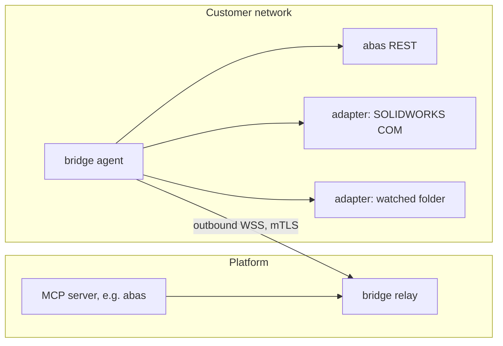

# MCP servers for the 20 largest German industries

This page checks whether we can build an MCP server for each product on the owner's list of the
top ten office software products in Germany's twenty largest industries (as of 2026-11-01). It
also says when we build each one. It extends [mcp-catalog.md](mcp-catalog.md), which keeps the
cross-industry candidates and their numbers (`#n`).

Each product was researched in the vendor's developer documentation, API portal or partner
programme. Where only third-party pages were found, or nothing at all, the row says so.

- `?` means no evidence was found.
- `(est.)` marks rows that could not be searched (the research ran out of searches). These are
  estimates from background knowledge and need a check before we plan them firmly.

## Ratings

| Rating | Meaning                                                                                                                                                |
| ------ | ------------------------------------------------------------------------------------------------------------------------------------------------------ |
| **A**  | Cloud API, and the customer or we can get access ourselves: an API key, a token from the customer's admin, or an OAuth app we register. Buildable now. |
| **B**  | There is an API, but we need either a partner contract and approval from the vendor, or an endpoint that the customer runs on its own premises.        |
| **C**  | Only a local desktop SDK or file exchange (GDT, GAEB, DATEV CSV), or so costly that it only makes sense as a customer project.                         |
| **–**  | No realistic way, or legally closed to us (Telematikinfrastruktur).                                                                                    |

The **Plan** column says what happens with each product:

| Plan         | Meaning                                                                                                    |
| ------------ | ---------------------------------------------------------------------------------------------------------- |
| `built`      | The server already exists.                                                                                 |
| `#n`         | The product is already a candidate in mcp-catalog.md.                                                      |
| `wave 1`     | Built first (see "Build plan").                                                                            |
| `wave 2`     | Built second.                                                                                              |
| `bridge`     | Wave 3: the product's API runs on the customer's premises and is reached through the on-premises bridge.   |
| `adapter`    | Wave 4: no API; a local adapter in the bridge agent drives the desktop SDK, local database or file folder. |
| `partner`    | Documented for partner talks; built once a partner contract or the vendor's approval exists.               |
| `file`       | No API: a server that reads or writes the exchange format, which the user moves in or out of the product.  |
| `ask vendor` | No evidence found; one email to the vendor settles whether it is A, B or C.                                |
| `no`         | Not planned.                                                                                               |

## What the research shows

- **Cloud software is almost always buildable.** International and German cloud products have
  public REST APIs with self-service keys or OAuth: weclapp, Xentral, Shopify, Shopware, HubSpot,
  Salesforce, apaleo, onOffice, Capmo, Dalux, Planday, Sendcloud, Veeva Vault and ArcGIS among
  them.
- **German industry software mostly runs on the customer's premises.** That covers the industry
  ERPs (abas, proALPHA, APplus, Sage 100, microtech, NAV), the MES and CAQ systems (MPDV HYDRA,
  FORCAM, Opcenter, CAQ.Net), the PDM and PLM systems (Teamcenter, SOLIDWORKS PDM), the LIMS and
  the DMS (enaio). Their REST APIs exist but are inside the customer's network. One generic
  bridge would open all of them at once.
- **Closed or partner-only systems.** Dealer management systems (Incadea, Locosoft, CDK),
  hospitality distribution (protel, Opera, SiteMinder), forwarding software (CargoSoft, WinSped)
  and the cores of banks and insurers are closed or only open to partners.
- **Desktop software.** CAD (NX, Solid Edge, Inventor, EPLAN P8, Moldflow) and old desktop
  software (ALCO, Haufe ImmobilienVerwaltung, ORCA AVA) only have local SDKs or file exchange.
- **Health care is legally fenced off.**
  - The Telematikinfrastruktur (ePA, E-Rezept, KIM) is open only to care providers with SMC-B
    and eHBA cards and approved components.
  - Practice software (CGM, medatixx, T2med) exchanges data through GDT and BDT or through
    partner interfaces.
  - § 393 SGB V lets practices and hospitals process health data in the cloud only if the
    provider and the SaaS on top of it both hold a C5 Type 2 attestation. Our platform does not
    hold one yet.
- **DATEV is the most frequent B.** It appears in 10 of the 20 lists. Its cloud APIs need a
  partner contract, DATEV's go-live approval (4–12 weeks) and a monthly fee plus a price per
  call (the amounts are not published).

## Decisions (2026-11-01)

1. **Every A product is planned.** It is built in wave 1 or wave 2.
2. **B products are documented for partner talks.** Products that need a partner contract or
   the vendor's approval are marked `partner`. They are taken up in partner talks once the
   company exists.

   B products whose API only runs at the customer (on-prem REST) do not need a contract. They
   come with the bridge in wave 3, and the customer provides the API documentation.

3. **On-premises bridge.** It is built and opens both on-prem APIs (wave 3) and C products
   (wave 4). It is also the base for custom connectors: a customer's own systems, described
   once, become tools without a dedicated server. The design is below.
4. **No patient data.**
   - Nothing that processes health or care data is built. That covers practice, hospital, care
     and pharmacy software and the Telematikinfrastruktur.
   - Doctolib (appointments only) stays a `partner` candidate, nothing more.

### Partner talks

The vendors below need a partner contract or their approval. Each application needs the company,
so the talks start once it is founded. The order is by reach in the lists:

1. DATEV: Marketplace partner, go-live approval, monthly fee plus a price per call. It is in 10 of
   the 20 lists.
2. JTL: app registration for the JTL Cloud gateway.
3. Aareon Connect: Wodis Sigma, Smart Platform, Mareon.
4. Mews: certification. The sandbox can be built before it.
5. Lightspeed Restaurant, Gastrofix, protel, SiteMinder, Cubilis, resmio, OpenTable: hospitality
   distribution and restaurants.
6. Transporeon, CargoSoft, Webfleet .connect, Transics, Blue Yonder, Descartes: logistics.
7. 365FarmNet, Lely: agriculture.
8. SAP Ariba, TrackWise, MasterControl, Addison OneClick, Haufe X360, FlowFact, itslearning,
   ImmoScout24 production approval: each on a customer's request.
9. Wilken, powercloud/Hansen, ZEMA, Allegro: utilities, on a customer's request.
10. Dealer DMS (CDK, Incadea, Locosoft), SupplyOn, Adobe Firefly Services: only with a large
    customer behind them.
11. Banking and insurance cores (Guidewire, Sapiens, Temenos, Avaloq, OSPlus, agree21) and BiPRO:
    recorded, but not pursued; they are projects for a single institution.

## On-premises bridge

- **Agent.** The customer runs it, as a container, or as a Windows service where a desktop SDK
  is needed.
  - It connects outbound to the platform's relay over WebSocket with mTLS. The customer opens no
    inbound port.
  - It forwards only to the targets listed in its local configuration, which the customer edits.
    The platform cannot add a target.
- **Enrolment.** The tenant admin creates a one-time enrolment code in the admin app. The agent
  exchanges it for a client certificate bound to the tenant. Revoking the certificate in the
  admin app cuts the agent off at once.
- **Relay.** It accepts calls from platform MCP servers with the verified tenant, never from
  LibreChat or the browser. It routes each call only to the agents of that tenant. Each call is
  bounded: size limit, timeout, rate limit per tenant.
- **Audit.** Each call is recorded on both sides, the relay and the agent's local log, with the
  same rules as the MCP audit: target, outcome, digest, never the payload.
- **Adapters (wave 4).** Plug-ins in the agent for systems without an API:
  - desktop SDKs (SOLIDWORKS, Inventor, NX, Solid Edge, EPLAN P8, Moldflow)
  - local databases, read-only (ALCO HOUSE, Haufe ImmobilienVerwaltung, Agrarmanager, SchILD-NRW,
    ASV-BW)
  - watched folders for exchange files (GAEB, DATEV CSV, VDA/EDIFACT, TaxMetall)
- **Custom connectors.** A customer, or we for them, describes local endpoints once as OpenAPI in
  the agent's configuration. A generic platform server turns those endpoints into tools with the
  usual scopes, tool policy and audit. That is the way in for a customer's in-house systems.
- **Updates.** Signed agent releases; the agent pins a version and reports it, so the admin app
  can show outdated agents.
- **Effort.** About two weeks for agent, relay, enrolment and the admin app's page. After that,
  each product is a normal server, and each adapter is about two to three days.

## Build plan

Each server takes about one to two days on `@anno/mcp-core`, with tests, the admin app's
catalog entry and the local stack wiring. Packages are offered as bundles (see the MCP pricing
in [architecture.md](architecture.md)).

**Wave 1: products that appear across many industries (cloud, self-service).** Built 2026-11-01
(anno-systems/mcp-servers#33); each server's README lists what still needs checking against a
first live account. The order weighs
how many of the 20 lists name the product ("Lists") against how common it is among small and
mid-sized customers, so Business Central comes before SAP:

| Order | Server                                         | Lists | Catalog  | Notes                                                                                         |
| ----- | ---------------------------------------------- | ----- | -------- | --------------------------------------------------------------------------------------------- |
| 1     | Microsoft Dynamics 365 Business Central        | 9     | #8       | Entra app with client credentials; also covers MODUS INDUSTRY and Aptean F&B, which run on BC |
| 2     | SAP S/4HANA Cloud and SAP Sales/Service Cloud  | 15    | #10      | The customer's admin creates a communication arrangement; no SAP partnership needed           |
| 3     | Salesforce (incl. Financial Services Cloud)    | 3     | #24      | External Client App (new Connected Apps are restricted since Spring '26)                      |
| 4     | HubSpot                                        | 1     | #22      |                                                                                               |
| 5     | weclapp                                        | 2     | #12      | Token per user                                                                                |
| 6     | Xentral                                        | 1     | #11      |                                                                                               |
| 7     | Shopify and Shopware 6                         | 1     | #42, #43 |                                                                                               |
| 8     | Asana, monday.com, Trello                      | 2     | #38, #39 |                                                                                               |
| 9     | Autodesk Platform Services (ACC, Docs, Fusion) | 4     | new      | Self-service OAuth app; covers construction and manufacturing                                 |

**Wave 2: industry packages (cloud, self-service).** Each package can be sold as an industry
bundle:

| Package                          | Servers                                                                                     |
| -------------------------------- | ------------------------------------------------------------------------------------------- |
| Real estate                      | onOffice, Propstack, ImmoScout24 (with casavi, built)                                       |
| Construction                     | Capmo, Dalux, Allplan Bimplus, GAEB files (`file`) (with PlanRadar and untermStrich, built) |
| Hospitality                      | apaleo, ready2order, Lightspeed Retail, Planday, Papershift, Staffomatic, Mews (sandbox)    |
| IT service providers             | ServiceNow, NinjaOne, ConnectWise PSA, TeamViewer, N-able N-sight and N-central             |
| Marketing and media              | WordPress, Drupal, CleverReach (#26), Figma, Canva, Bynder, Frame.io, AEM Assets            |
| Logistics                        | Sendcloud (#45), Webfleet, project44, DSV, Dynamics 365 SCM                                 |
| Education and public sector      | Moodle, d.velop documents (#34), WebUntis (est.)                                            |
| Pharma and chemicals             | Veeva Vault                                                                                 |
| Agriculture                      | HI-Tier (livestock register), agrirouter (data hub)                                         |
| Utilities                        | Esri ArcGIS                                                                                 |
| Electronics                      | Altium 365                                                                                  |
| Finance                          | finAPI bank accounts (#6, licence from €60 a month)                                         |
| Manufacturing (larger customers) | Infor ION (the customer's admin registers the app)                                          |

**Wave 3: the bridge and on-prem APIs (`bridge`).** The bridge comes first. Then, in order of
reach:

- ERP: SAP Business One and S/4HANA or ECC on-prem, Dynamics NAV, proALPHA, abas, Sage 100,
  APplus, ams.erp, microtech, GUS-OS
- Engineering and manufacturing:
  - PDM and PLM: SOLIDWORKS PDM, Autodesk Vault, Teamcenter, 3DEXPERIENCE
  - MES: MPDV HYDRA, FORCAM, Opcenter, DELMIA
  - CAQ.Net
  - Lobster (EDI)
- Industry and documents:
  - LabWare and SampleManager LIMS
  - enaio, Fabasoft
  - NEVARIS, SAP RE-FX, SAP TM/EWM, SAP IS-U, Smallworld
  - Méthode, WoodWing, Censhare
  - DATEVconnect in the firm, TYPO3 headless

Each server is built when a customer brings the system, since the API documentation often comes
from the customer.

**Wave 4: adapters for C products (`adapter`).** They are built in the bridge agent, again on a
customer's request:

- CAD and CAE: SOLIDWORKS, Inventor, NX, Solid Edge, EPLAN Electric P8, Moldflow
- Local databases: ALCO HOUSE, Haufe ImmobilienVerwaltung, Agrarmanager, DairyPlan, DelPro,
  SchILD-NRW, ASV-BW
- Exchange files in watched folders: TaxMetall, AnNoText exports, TRUMPF TruTops job lists

## Per industry

### 1. Trade (wholesale, retail, car dealers)

| Software                                       | Rating    | Access                                                               | Plan           |
| ---------------------------------------------- | --------- | -------------------------------------------------------------------- | -------------- |
| SAP S/4HANA / Business One                     | A / B     | S/4 Cloud: communication arrangement; B1 Service Layer on-prem       | built / bridge |
| Microsoft Dynamics 365 Business Central        | A         | Entra app, client credentials                                        | built          |
| JTL-Wawi                                       | B         | JTL Cloud gateway, app registration with JTL                         | partner        |
| Lexware Warenwirtschaft                        | –         | Desktop, no API (Lexware Office is built)                            | no             |
| Sage 100                                       | B         | On-prem Web API (sources disagree)                                   | bridge         |
| weclapp / Xentral                              | A         | Token from the customer                                              | built          |
| Lightspeed / ready2order / Vectron             | A / A / ? | Lightspeed Retail OAuth, ready2order token; Vectron only via partner | wave 2         |
| Shopware / Shopify                             | A         | Integration key / OAuth app                                          | built          |
| CDK / Autosoft, Incadea, Locosoft (dealer DMS) | B / ?     | Partner only; CDK's marketplace is US-focused                        | partner        |
| DATEV                                          | B         | Partner contract                                                     | partner        |

### 2. Automotive (manufacturers and suppliers)

| Software                                   | Rating | Access                                                    | Plan                                            |
| ------------------------------------------ | ------ | --------------------------------------------------------- | ----------------------------------------------- |
| SAP S/4HANA / ECC                          | A / B  | Cloud via communication arrangement, ECC on-prem          | built / bridge                                  |
| Siemens Teamcenter                         | B      | On-prem or Teamcenter X; REST/SOA                         | bridge                                          |
| Dassault 3DEXPERIENCE / CATIA              | B / C  | 3DSpace REST per customer; CATIA local SDK only           | bridge                                          |
| Siemens NX                                 | C      | Local SDK (NX Open)                                       | adapter                                         |
| SAP Ariba                                  | B      | App on developer.ariba.com, the customer's realm approves | partner                                         |
| Odette/VDA EDI, OFTP2 (Seeburger, Lobster) | B      | Lobster REST on the customer's system                     | bridge; `file` for reading VDA/EDIFACT messages |
| SupplyOn / Covisint                        | C      | EDI integration projects only                             | partner                                         |
| IMDS                                       | –      | Web UI and file upload, no API                            | no                                              |
| CAQ (CAQ AG, Babtec)                       | B / ?  | CAQ.Net REST on-prem; Babtec unclear                      | bridge                                          |
| MES (Opcenter, DELMIA, MPDV HYDRA)         | B      | REST on-prem or MIP                                       | bridge                                          |

### 3. Health care (practices, hospitals, care, pharmacies)

| Software                                 | Rating      | Access                                                                    | Plan                 |
| ---------------------------------------- | ----------- | ------------------------------------------------------------------------- | -------------------- |
| CGM TURBOMED, MEDISTAR, ALBIS, x.isynet  | C           | GDT/BDT/LDT on a local computer, partner agreement                        | no (no patient data) |
| medatixx / x.concept                     | B           | "HealthHub" for partners (since 2026-01)                                  | no (no patient data) |
| T2med, Medical Office, tomedo            | B? / C / B? | T2med via partners; Medical Office HL7/GDT; tomedo's API is in the making | no (no patient data) |
| Doctolib (not on the list)               | B           | Partner API: slots and bookings                                           | partner              |
| Hospital IS (ORBIS, M-KIS, CGM CLINICAL) | B / C       | HL7, FHIR and ISiK at the hospital                                        | no (no patient data) |
| SAP IS-H, Epic                           | – / B       | IS-H out of maintenance in 2027; Epic hardly used in Germany              | no                   |
| Care (Medifox DAN, Vivendi, CGM SOCIAL)  | ? / C       | No public API                                                             | no (health data)     |
| Pharmacies (Awinta, IXOS, CGM Lauer)     | C           | Partner interfaces only                                                   | no (health data)     |
| TI (KIM, E-Rezept, ePA, Konnektor)       | –           | Care providers with SMC-B/eHBA only                                       | no                   |

### 4. Mechanical engineering

| Software                                   | Rating | Access                                                     | Plan             |
| ------------------------------------------ | ------ | ---------------------------------------------------------- | ---------------- |
| SAP S/4HANA / ECC                          | A / B  | See above                                                  | built / bridge   |
| proALPHA                                   | B      | REST (ray API) or n8n integration platform at the customer | bridge           |
| abas                                       | B      | REST web services on-prem                                  | bridge           |
| Dynamics 365 / NAV                         | A / B  | BC online; NAV OData on-prem                               | built / bridge   |
| Infor CloudSuite Industrial                | A/B    | ION API, the customer's admin creates the app              | wave 2           |
| Teamcenter / Solid Edge                    | B / C  | See above                                                  | bridge / adapter |
| SOLIDWORKS PDM                             | B      | PDM Web API on the customer's vault server                 | bridge           |
| Autodesk Inventor / Vault                  | C / B  | Inventor local; Vault Data API (2025.2+)                   | adapter / bridge |
| MES/BDE (MPDV HYDRA, FORCAM)               | B      | MIP REST; FORCAM Bridge API with credentials from FORCAM   | bridge           |
| CRM/service (Salesforce, SAP CX, Dynamics) | A      | OAuth app / communication arrangement / Entra              | built            |

### 5. Real estate and housing

| Software                              | Rating    | Access                                         | Plan                       |
| ------------------------------------- | --------- | ---------------------------------------------- | -------------------------- |
| Wodis Sigma (Aareon)                  | B         | Aareon Connect, partner contract               | partner                    |
| SAP RE-FX                             | B         | OData in the customer's S/4                    | bridge                     |
| GES / Haufe PowerHaus                 | B?        | Only individual interfaces (casavi, EverReal)  | ask Haufe                  |
| Immoware24                            | ?         | No API documented                              | ask vendor                 |
| DOMUS 4000, ALCO HOUSE, KARTHAGO2000  | ? / C / ? | DATEV and Outlook interfaces only              | adapter (ALCO); ask vendor |
| Haufe ImmobilienVerwaltung            | C         | Desktop, accounting export                     | adapter                    |
| Aareon Smart Platform / Mareon        | B         | Aareon Connect                                 | partner                    |
| onOffice                              | A         | API user from the customer (HMAC)              | wave 2                     |
| ImmoScout24                           | A/B       | OAuth 1.0a consumer key, production approval   | wave 2                     |
| Propstack, FlowFact (not on the list) | A / B     | Key in settings / unlocked by FlowFact support | wave 2 / partner           |
| casavi                                | A         |                                                | built                      |

### 6. Construction

| Software                            | Rating | Access                                                 | Plan                         |
| ----------------------------------- | ------ | ------------------------------------------------------ | ---------------------------- |
| NEVARIS                             | B      | Nevaris Build HTTP API on the customer's installation  | bridge                       |
| RIB California.pro / iTWO 4.0       | B / ?  | iTWO 4.0 lists "public APIs", no docs                  | ask RIB                      |
| ORCA AVA                            | C      | GAEB XML, Datanorm                                     | `file` (GAEB server, wave 2) |
| SIDOUN Globe, BRZ, DBD-BauDaten     | ?      | Only DATEV and GAEB interfaces found                   | `file`                       |
| Allplan (Bimplus)                   | A      | Developer registration, token                          | wave 2                       |
| Autodesk Revit / AutoCAD (APS, ACC) | A      | Self-service APS app; the customer's ACC admin adds it | built                        |
| Microsoft 365                       | A      |                                                        | built                        |
| DATEV                               | B      |                                                        | partner                      |
| PlanRadar / Dalux / Capmo           | A      | Personal token / API identity / key                    | built / wave 2 / wave 2      |
| Powerbau, TOPIX, 123erfasst         | ?      | No docs; 123erfasst is retiring its REST APIs          | ask vendor                   |

### 7. Chemicals and pharma

| Software                           | Rating | Access                                          | Plan           |
| ---------------------------------- | ------ | ----------------------------------------------- | -------------- |
| SAP S/4HANA                        | A / B  |                                                 | built / bridge |
| Veeva Vault                        | A      | The customer's Vault user or OAuth profile      | wave 2         |
| LabWare LIMS, Thermo SampleManager | B      | REST at the customer (SampleManager from v21.3) | bridge         |
| Dynamics 365 (ORDAT)               | A      | Like BC                                         | built          |
| CSB-System                         | ?      | No REST docs found                              | ask vendor     |
| GUS-OS Suite                       | B      | "Digital Hub" REST                              | bridge         |
| Siemens Opcenter                   | B      |                                                 | bridge         |
| TrackWise Digital / MasterControl  | B      | Salesforce org of the customer / API licence    | partner        |
| Microsoft 365 / SharePoint         | A      |                                                 | built          |

### 8. Food

| Software                                  | Rating | Access               | Plan           |
| ----------------------------------------- | ------ | -------------------- | -------------- |
| SAP S/4HANA / Business One                | A / B  |                      | built / bridge |
| CSB-System                                | ?      |                      | ask vendor     |
| Dynamics 365 / NAV, Aptean F&B (on BC)    | A / B  | BC API               | built          |
| GUS-OS, proALPHA                          | B      |                      | bridge         |
| Infor CloudSuite F&B                      | A/B    | ION API              | wave 2         |
| microtech büro+                           | B      | REST, mostly on-prem | bridge         |
| weclapp                                   | A      |                      | built          |
| QM for IFS/BRC/HACCP (e.g. SafetyCulture) | ?      | Not confirmed        | check          |

### 9. Electrical industry

| Software                             | Rating    | Access                                               | Plan                       |
| ------------------------------------ | --------- | ---------------------------------------------------- | -------------------------- |
| EPLAN Electric P8 / Pro Panel        | C / ?     | P8 local SDK (EADN licence); EPLAN Cloud partly REST | adapter; check EPLAN Cloud |
| SAP S/4HANA, proALPHA, Dynamics 365  | see above |                                                      | built / bridge             |
| ORDAT.ERP, TaxMetall                 | ? / C     | No API; TaxMetall only DATEV and GAEB files          | ask vendor / adapter       |
| Siemens NX / Teamcenter              | C / B     |                                                      | adapter / bridge           |
| Altium 365                           | A         | Workspace token, GraphQL                             | wave 2                     |
| Trade software (Lexware, Sage, hero) | A / B / ? | Lexware Office built; hero has no public docs        | built / ask hero           |
| Microsoft 365 / Teams                | A         |                                                      | built / #28                |

### 10. IT and telecommunications

| Software                                  | Rating | Access                                                      | Plan            |
| ----------------------------------------- | ------ | ----------------------------------------------------------- | --------------- |
| Jira, Confluence, GitLab, GitHub          | A      |                                                             | built           |
| ServiceNow                                | A      | The customer's admin registers an OAuth app in its instance | wave 2          |
| Microsoft 365 / Teams / Entra             | A      |                                                             | built / #28     |
| SAP S/4HANA or Dynamics 365               | A      |                                                             | built           |
| Salesforce / HubSpot                      | A      |                                                             | built           |
| ConnectWise PSA / NinjaOne / N-able       | A      | Keys or OAuth app from the customer                         | wave 2          |
| TeamViewer                                | A      | OAuth client app                                            | wave 2          |
| DATEV or Lexware                          | B / A  |                                                             | partner / built |
| Telecom BSS/OSS (Amdocs, Netcracker, CSG) | B/C    | Inside the operator's network                               | no              |

### 11. Business services (consulting, law, tax, advertising)

| Software                                  | Rating | Access                                                               | Plan                                 |
| ----------------------------------------- | ------ | -------------------------------------------------------------------- | ------------------------------------ |
| DATEV (firm software, cloud APIs)         | B      | Marketplace partner, go-live approval, fees                          | partner                              |
| DATEV Anwalt classic/pro                  | C      | DATEVconnect runs in the firm                                        | bridge                               |
| RA-MICRO                                  | –      | REST interface announced, not published                              | watch                                |
| Advolux / AnNoText                        | ? / C  | No public API                                                        | ask vendor / adapter                 |
| advoware                                  | A      |                                                                      | built                                |
| beA                                       | –      | Only for law firm software vendors; never with write or send rights  | no                                   |
| Addison (Wolters Kluwer)                  | B      | OneClick API for partners                                            | partner                              |
| Haufe Suite / X360                        | ? / B  | X360 REST through the implementation partner                         | partner                              |
| SAP S/4HANA / Business One                | A / B  |                                                                      | built / bridge                       |
| Microsoft 365 / Teams                     | A      |                                                                      | built                                |
| Adobe Creative Cloud, Asana, Jira, monday | B / A  | Firefly APIs only with an enterprise contract; Frame.io self-service | Frame.io wave 2; Asana, monday built |
| Federal law (not on the list)             | A      |                                                                      | built                                |

### 12. Finance and insurance

| Software                                         | Rating | Access                                                     | Plan            |
| ------------------------------------------------ | ------ | ---------------------------------------------------------- | --------------- |
| SAP (S/4HANA Finance, Fioneer)                   | B      | Customer's system                                          | bridge          |
| Guidewire, msg.Insurance Suite, Adcubum, Sapiens | B / ?  | Partner-gated or no docs                                   | partner         |
| Temenos, Avaloq, FIS                             | B      | Bank-hosted                                                | partner         |
| Finanz Informatik OSPlus, Atruvia agree21        | B / ?  | Third parties must be validated by FI                      | partner         |
| Microsoft 365 / Teams                            | A      |                                                            | built           |
| Salesforce Financial Services Cloud              | A      |                                                            | built           |
| BiPRO (brokers)                                  | B      | Contract with each insurer                                 | partner         |
| Broker management software                       | ?      | No APIs found                                              | ask vendor      |
| Bank accounts via PSD2 (finAPI)                  | A/B    | Licence from €60 a month; GoCardless takes no new sign-ups | #6, with finAPI |

### 13. Logistics and transport

| Software                                    | Rating  | Access                                         | Plan             |
| ------------------------------------------- | ------- | ---------------------------------------------- | ---------------- |
| SAP TM / EWM                                | B       | OData via communication arrangement or on-prem | bridge           |
| CargoSoft                                   | B       | API users only through CargoSoft               | partner          |
| WinSped, TraffixSpedi                       | ?       | No API docs                                    | ask vendor       |
| Transporeon (Trimble)                       | B       | Credentials through Transporeon                | partner          |
| Blue Yonder TMS, Descartes                  | B       | Customer contract                              | partner          |
| Dynamics 365 SCM                            | A       | Entra app in the customer's tenant             | wave 2           |
| Webfleet / Transics                         | A/B / B | API key by form / SOAP via the account manager | wave 2 / partner |
| project44, DSV, Sendcloud (not on the list) | A       | Customer app / subscription key / keys         | wave 2           |
| Microsoft 365                               | A       |                                                | built            |

### 14. Energy supply

The research ran out of searches for most of this list.

| Software                                | Rating       | Access                               | Plan                              |
| --------------------------------------- | ------------ | ------------------------------------ | --------------------------------- |
| SAP IS-U / S/4HANA Utilities            | B (est.)     | The customer's SAP                   | bridge                            |
| Schleupen CS.3                          | B?           | "Web-API" and Developer Campus exist | ask vendor                        |
| Wilken ENER:GY, powercloud (now Hansen) | B (est.)     | Partner                              | partner                           |
| Market communication (EDIFACT, AS4)     | –            | Market roles only                    | `file` at most (explain messages) |
| GIS: Esri ArcGIS / Smallworld           | A / B (est.) | ArcGIS API key or OAuth              | wave 2 / bridge                   |
| Energy trading (ZEMA, Allegro)          | B/C (est.)   |                                      | partner                           |
| Microsoft 365, DATEV, Haufe             | A / B        |                                      | built / partner                   |

### 15. Metal production and processing

| Software                               | Rating    | Access                  | Plan                    |
| -------------------------------------- | --------- | ----------------------- | ----------------------- |
| SAP, proALPHA, Business Central, Infor | see above |                         | built / bridge / wave 2 |
| ams.erp                                | B?        | REST mentioned, no docs | bridge                  |
| APplus                                 | B         | SOAP/REST on-prem       | bridge                  |
| MES (HYDRA, FORCAM)                    | B         |                         | bridge                  |
| Stahl Control, TRUMPF TruTops          | ? / C     | No API                  | ask vendor / adapter    |
| CAD/CAM (Inventor, SolidWorks)         | C         | Local SDKs              | adapter                 |
| Microsoft 365                          | A         |                         | built                   |

### 16. Public administration, education and social services

| Software                                                                | Rating        | Access                                                                | Plan                        |
| ----------------------------------------------------------------------- | ------------- | --------------------------------------------------------------------- | --------------------------- |
| Municipal IT services' Fachverfahren (AKDB, Komm.ONE, Dataport, ekom21) | C             | XÖV over OSCI/XTA between authorities, not per user                   | no                          |
| Infoma newsystem                                                        | ?             |                                                                       | ask vendor                  |
| SAP S/4HANA Public Sector                                               | B             |                                                                       | bridge                      |
| d.velop documents                                                       | A             | API key in the customer's cloud tenant                                | wave 2 (#34)                |
| enaio, Fabasoft eAkte                                                   | B             | REST/SOAP at the customer                                             | bridge                      |
| Kita software (KidiCap, Little Bird, KiTa-Navigator)                    | ? (est.)      | Not researched                                                        | check                       |
| School administration (SchILD-NRW, Untis, ASV-BW, Schulmanager)         | C / B (est.)  | SchILD and ASV are local databases; WebUntis has a JSON-RPC interface | WebUntis wave 2 after check |
| Learning platforms (Moodle, ILIAS, itslearning, Teams)                  | A / ? / B / A | Moodle token from the admin; itslearning through sales                | Moodle wave 2               |
| Microsoft 365 / openDesk                                                | A / B         | openDesk components (Nextcloud #32, OpenProject #40) self-hosted      | built / catalog             |
| Vivendi, Tau-Office                                                     | C (est.)      |                                                                       | no (care data)              |

### 17. Hospitality and tourism

| Software                            | Rating    | Access                                               | Plan                 |
| ----------------------------------- | --------- | ---------------------------------------------------- | -------------------- |
| protel PMS                          | B         | Integration partner with certification               | partner              |
| Oracle Opera Cloud                  | B         | Oracle Partner Network, pay per call                 | partner              |
| apaleo                              | A         | The hotel's admin creates the app                    | wave 2               |
| Mews                                | A/B       | Free sandbox; production needs certification         | partner              |
| Hotelfriend / Casablanca            | ? / B     | Partner interfaces only                              | partner              |
| SiteMinder / Cubilis / D-EDGE       | B         | Partner contracts                                    | partner              |
| orderbird / ready2order / Gastrofix | ? / A / B | ready2order token; Gastrofix approves per restaurant | wave 2 (ready2order) |
| resmio / OpenTable / Quandoo        | B         | Partner approval; Quandoo reportedly winding down    | partner              |
| Planday / Papershift / Staffomatic  | A         | Keys or OAuth from the customer                      | wave 2               |
| DATEV                               | B         |                                                      | partner              |

### 18. Rubber and plastics

| Software                                        | Rating    | Access                    | Plan                    |
| ----------------------------------------------- | --------- | ------------------------- | ----------------------- |
| SAP, proALPHA, ams.erp, Infor, Business Central | see above |                           | built / bridge / wave 2 |
| MODUS INDUSTRY                                  | A/B       | Built on Business Central | with BC (built)         |
| MPDV HYDRA                                      | B         |                           | bridge                  |
| Sage 100                                        | B         |                           | bridge                  |
| CAD/simulation (Moldflow, SOLIDWORKS, CATIA)    | C         | Local SDKs                | adapter                 |
| Microsoft 365 / DATEV                           | A / B     |                           | built / partner         |

### 19. Agriculture, forestry and fishing

| Software                                          | Rating       | Access                                                         | Plan                     |
| ------------------------------------------------- | ------------ | -------------------------------------------------------------- | ------------------------ |
| NEXT Farming / FarmFacts                          | ?            | No public API; assets went to AGCO in 2023                     | ask vendor               |
| 365FarmNet (CLAAS)                                | B            | Partner registration (devcon.365farmnet.com)                   | partner                  |
| Agrarmanager / Eurosoft (Land-Data)               | C (est.)     | Desktop                                                        | adapter                  |
| farmdok                                           | ?            | No docs                                                        | ask vendor               |
| HIT database (HI-Tier)                            | A/B          | REST with OIDC, the farmer's own login; check the terms of use | wave 2                   |
| ELAN state portals                                | – (est.)     | Application portals without an API                             | no                       |
| Herd management (DairyPlan, Lely Horizon, DelPro) | C / B (est.) | Mostly local; Lely cloud via partner                           | adapter / partner (Lely) |
| agrirouter (not on the list)                      | A/B          | Developer account, the farmer connects the endpoint            | wave 2                   |
| DATEV, Microsoft 365, Google Workspace            | B / A        |                                                                | partner / built          |

### 20. Media, publishing and creative industries

| Software                                         | Rating        | Access                                                         | Plan                                       |
| ------------------------------------------------ | ------------- | -------------------------------------------------------------- | ------------------------------------------ |
| Adobe Creative Cloud                             | B             | Firefly/Photoshop/InDesign APIs need an enterprise contract    | partner (Firefly); Frame.io wave 2         |
| Editorial systems (Méthode, WoodWing, Censhare)  | B             | REST at the customer's or hosted system                        | bridge                                     |
| Publishing software (Klopotek)                   | ?             | No API docs                                                    | ask vendor                                 |
| DAM (Censhare, AEM Assets, Bynder)               | B / A/B / A   | Bynder OAuth; AEM via Adobe Developer Console                  | Bynder wave 2                              |
| Web CMS (WordPress, TYPO3, Contao, Drupal)       | A / C / – / A | Application passwords / no core API / – / JSON:API             | wave 2 (WordPress, Drupal); bridge (TYPO3) |
| Project management (Asana, monday, Jira, Trello) | A             |                                                                | built                                      |
| Acrobat, Pubble, CleverReach                     | B / – / A     | CleverReach OAuth                                              | CleverReach wave 2 (#26)                   |
| Microsoft 365, Slack, Google Workspace           | A             |                                                                | built                                      |
| DATEV, lexoffice, sevDesk                        | B / A         |                                                                | partner / built                            |
| Figma, Canva, Affinity                           | A / A / –     | Figma token or OAuth; Canva Connect (review rules unconfirmed) | wave 2                                     |

## Still to check

Some rows could not be researched and are estimates. Before they get a firm place in the plan,
check:

- Lely, DeLaval, GEA, Land-Data, ELAN
- SAP IS-U, Wilken, powercloud/Hansen, Smallworld, ZEMA, Allegro
- KidiCap, Little Bird, KiTa-Navigator, SchILD-NRW, WebUntis, ASV-BW, Schulmanager, Vivendi,
  Tau-Office
- Autodesk Inventor

For the niche German vendors marked `?`, a short email asking for an API or partner programme
settles the question faster than more searching: Immoware24, DOMUS, KARTHAGO, SIDOUN, BRZ,
Powerbau, CSB-System, WinSped, TraffixSpedi, hero and farmdok.
